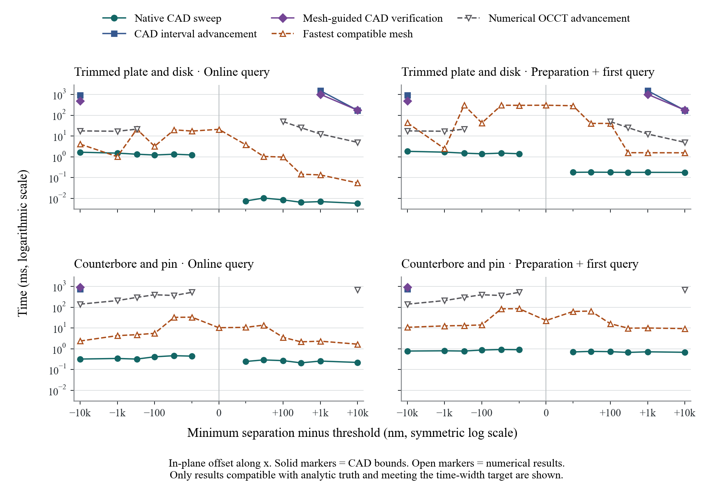

# Near-threshold clearance accuracy and cost

The scan fixes the threshold at 0.03125 mm and varies the signed gap \(d_{\min}-\delta\) in two generated, reimported STEP fixtures. The disk crosses the plane of a plate with a circular trim. The pin travels from the wide counterbore into its smaller cylindrical throat. A negative signed gap indicates an event. A positive gap indicates a clear path. At zero, the gap touches the threshold and still counts as an event.

The principal scan uses a fixed in-plane offset direction along `x`. It covers both signs at 10 µm, 1 µm, 300 nm, 100 nm, 30 nm and 10 nm, plus equality. A diagonal in-plane offset with components in the ratio `3:4` checks both signs at 100 and 10 nm. All trajectories are translations on normalized time `[0,1]`. The first-event time target is `5e-4` for every method.

Let \(r\) be the radius of the critical rim, \(a\) the moving radius, and \(e\) the in-plane eccentricity. The minimum separation is \(g=r-a-e\). For \(g\le\delta\), the first event occurs when the moving face first comes within vertical distance \(\sqrt{\delta^2-g^2}\) of the rim. The counterbore path stays clear of the wider rim and reaches into the smaller cylindrical throat. The auditor uses this formula, the parsed binary64 offsets and 70-digit decimal arithmetic. The geometry is the nominal STEP design.

The [baseline definitions](../README.md#continuous-clearance-baselines) give the five query methods and their work limits. Every mesh query uses one of six independently prepared triangulations with nominal deflection settings from 50 µm down to 6.1 nm. These settings are mesher inputs. The mesh results and numerical OCCT advancement carry numerical evidence. The native sweep, CAD interval advancement and mesh-guided CAD verification can prove a complete clear interval or prove both ends of a first-event bracket. They may also provide a safe prefix before reaching their budget.

Each configuration warms up once and contributes three timed repetitions in rotating method order. `median_ms` is the online median. `prepare_ms` is the measured preparation for the given case. `pooled_prepare_ms` is the preparation median across offsets for the same fixture, method and resolution. Since only placement changes, that preparation can be reused. `first_query_ms` estimates first use by adding the pooled preparation median to the warmed online median. STEP input reading is outside both costs.

The [raw query records](observations.csv) and [audited summary](summary.csv) include the false reports, early brackets, wide brackets and unresolved results. `cad_certificate` records a complete clear interval, an event bracket, a safe prefix, or the absence of a CAD certificate. The mesh curve picks the least expensive tested setting that passes the analytic audit at each point using the analytic answer after measurement. The plot shows the primary `x` offset sweep. The summary also records the diagonal checks.



## Results

The 34 motions produced 1,020 timed records in MSVC Release with OCCT 7.9.3 on a Ryzen 9 5900X. The native sweep certifies all 16 clear paths and 13 of the 18 event paths within the requested width. CAD interval advancement and the mesh-guided CAD method each resolve 4 of 34 paths within target. Numerical OCCT advancement agrees with the analytic answer and meets the target on 17 paths. The fixed 3.125 µm mesh setting agrees and meets the target on 10 paths. The fixed 6.104 nm setting agrees on all 34 paths, with pooled preparation of 282 ms for the plate and disk and 2,620 ms for the counterbore and pin. The mesh has no CAD distance certificate.

At a signed gap of −10 nm and offset along `x`, the following mesh settings are the fastest tested numerical options that pass the analytic audit.

| Fixture | Native preparation (ms) | Native online (ms) | Compatible mesh setting | Mesh preparation (ms) | Mesh online (ms) |
| --- | ---: | ---: | ---: | ---: | ---: |
| Trimmed plate and disk | 0.172 | 1.230 | 6.104 nm | 281.752 | 17.282 |
| Counterbore and pin | 0.460 | 0.445 | 390.625 nm | 51.778 | 33.279 |

Changing the offset direction leaves the analytic answer effectively unchanged at the reported precision. The native sweep obtains 24 of 26 full results along `x` and 5 of 8 on the diagonal. At −100 nm in the counterbore the diagonal query takes 953.30 ms, versus 0.41 ms along `x`. In the two diagonal plate event cases and the diagonal −10 nm counterbore event, the native sweep places the end of the safe prefix within \(1.5\times 10^{-10}\) normalized time of the analytic event and exhausts the budget before obtaining an upper witness. Both exact-equality paths also return safe prefixes. The data isolate the effect of threshold proximity and offset direction for these circular fixtures.

## Reproduce

Use the Release binaries and the [OCCT runtime setup](../../../README.md). The figure requires Matplotlib.

```powershell
$scan = 'build/threshold-scan'
python benchmarks/assemblies/threshold_scan.py prepare $scan
cmake --build build/occt --config Release --target nc_assembly_bench nc_clearance_followup
$bench = 'build/occt/Release/nc_assembly_bench.exe'
$fixtures = 'build/occt/Release/nc_clearance_followup.exe'
& $fixtures audit $scan "$scan/edge-fixture.csv" 1
& $fixtures counterbore $scan "$scan/counterbore-fixture.csv" 1
& $bench compare-pair "$scan/edge-plate.step" "$scan/edge-disk.step" "$scan/trim-edge.txt" "$scan/trim-edge.csv" 3 --refine-mesh --external-reference
& $bench compare-pair "$scan/counterbore.step" "$scan/pin.step" "$scan/counterbore.txt" "$scan/counterbore.csv" 3 --refine-mesh --external-reference
& $bench compare-pair "$scan/edge-plate.step" "$scan/edge-disk.step" "$scan/trim-edge-diagonal.txt" "$scan/trim-edge-diagonal.csv" 3 --refine-mesh --external-reference
& $bench compare-pair "$scan/counterbore.step" "$scan/pin.step" "$scan/counterbore-diagonal.txt" "$scan/counterbore-diagonal.csv" 3 --refine-mesh --external-reference
python benchmarks/assemblies/threshold_scan.py audit "$scan/summary.csv" "$scan/trim-edge.csv" "$scan/counterbore.csv" "$scan/trim-edge-diagonal.csv" "$scan/counterbore-diagonal.csv" --repeats 3 --include-diagonal
python benchmarks/assemblies/plot_threshold_scan.py "$scan/summary.csv" "$scan/cost.png"
```
