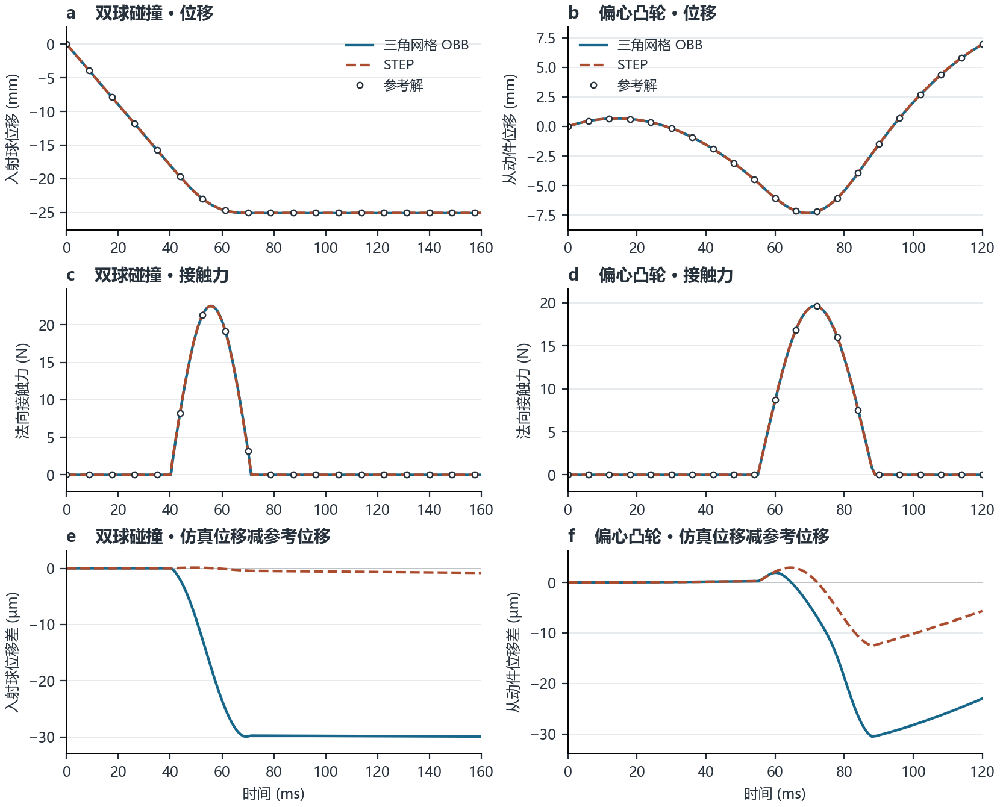
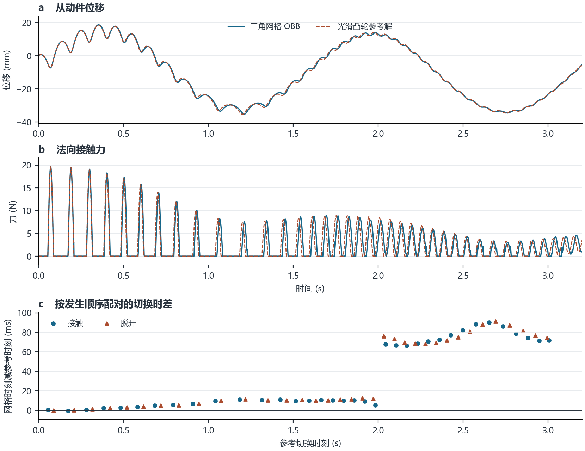
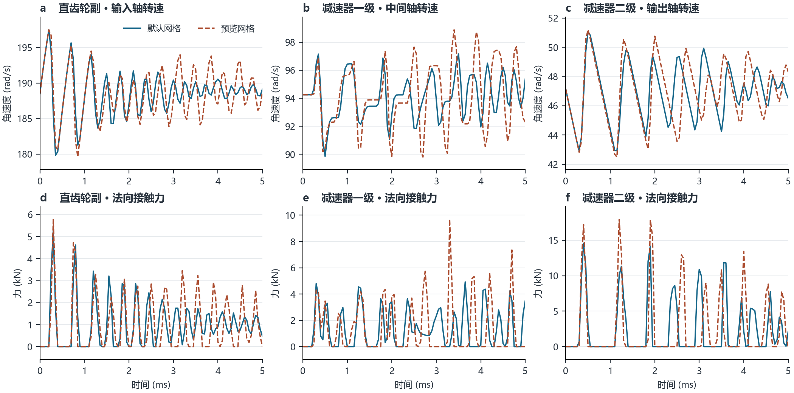
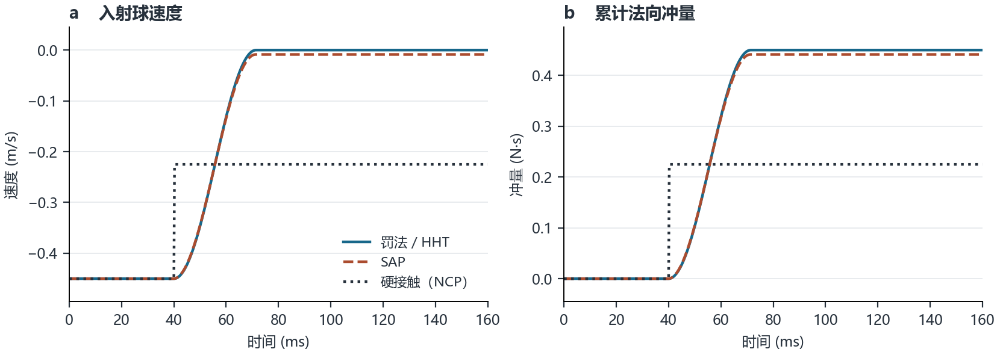

# 通用 CPU 刚体接触后端的响应与效率

2026-11-24。轻量网格能复现本次齿轮和减速器对照网格的带载响应。原始 STEP 接触在双球和凸轮短时段有较小的位移误差，代价是更长的在线时间。通用 STEP 后端已在 30 分钟内完成齿轮首次加载的 0.35 ms，完整啮合周期仍待验证。四页图集和下方 CSV 保留实际输出时间和数值，曲线均未平滑或平移。[响应曲线 PDF](response-curves.pdf)

## 已完成的同模型对照

表中是同一行模型、载荷、罚法和 HHT 设置下各几何方法的**在线积分秒数**。初始化、建网、CAD 抽样核验及写出耗时单列。共享 Windows 工作站上的各配置为单次计时。Chen 2024 调用作者的 TDIB 算法，Chen 2026 为项目按论文思路实现的变体。三条 STEP 路线共用原始实体的受力计算，区别在于如何寻找步内接触事件。

| 工况 | 仿真时长 | 主步长 / 事件时间容差 | 三角网格 OBB | STEP 距离推进 | STEP + Chen 2024 | STEP + Chen 2026 变体 |
|---|---:|---:|---:|---:|---:|---:|
| 双球碰撞，1,808 片 | 160 ms | 250 / 50 µs | 3.36 | 61.07 | 51.33 | 43.59 |
| 偏心凸轮首次接触与脱开，1,426 片 | 120 ms | 1,000 / 200 µs | 2.68 | 8.29 | 28.75 | 8.51 |
| 直齿轮副首次加载段，20,456 片，原全实体搜索 | 0.35 ms | 50 / 25 µs | 40.49 | 超时 | 超时 | 超时 |
| 同一直齿轮副，局部 STEP 复测 | 0.35 ms | 50 / 25 µs | 68.25 | 714.16 | 718.97 | 726.36 |

齿轮优化前三条 STEP 路线都在 1,800 s 截止。优化后仅对可接触的局部 STEP 实体计算距离和受力，并根据该区域的相对运动约束步内搜索。三条都完成了七步，输出文件逐字节相同。局部 STEP 一行的各进程在同一工作站上重叠运行。配对复测首个 50 µs 无载步，全实体和局部 STEP 在线分别用时 394.54 和 65.22 s，距离查询从 19 次降至 7 次，几何特征求极值从 9,314 次降至 2,487 次。[首步配对记录](../general-contact/spur-local-first-step.json) · [七步对照与截止记录](../../../benchmarks/chen/README.md#gear-distance-and-event-costs) · [双球各方法记录](../general-contact/surface-methods-impact.json) · [凸轮对照](../../../benchmarks/chen/README.md#rigid-step-scenes)

在同一工作站先后单独运行网格和局部 STEP 距离推进，在线耗时分别为 36.14 和 388.21 s，后者约为前者的 10.74 倍。两者分别复现了上表对应的响应文件。首次加载段的 8 帧输出中有 3 帧承载。三个 STEP 方法的采样峰值为 5.377 kN，网格为 5.848 kN。用完整 STEP 实体在相同姿态重算，8 个输出姿态及首次加载附近 3 个插值姿态的接触区数、受力点、法向和深度均与局部实体相同。完整啮合周期的齿轮精度仍需独立参考解。[顺序运行网格](../general-contact/spur-serial-mesh-obb.json) · [顺序运行 STEP](../general-contact/spur-serial-cad-occt.json) · [全实体逐姿态核对](../general-contact/spur-local-regions.json) · [接触力和轴转速曲线](../general-contact/spur-local-response.png)

在相同的 0.35 ms 齿轮首次加载段上，通用 STEP 后端重算上一姿态的最近特征对，用当前距离和沿最近点方向建立的包围盒共同裁剪 BVH。两轮分别单跑，优化前后在线用时为 681.08 → 228.69 s 和 226.44 → 255.10 s，纯网格分别为 32.71 和 28.51 s。精确特征查询均由 45,382 次降至 33,082 次，整段耗时的改善未复现。两个 STEP 版本的 8 帧响应文件逐字节相同。用各自保存的轴姿态插值回放，完整 STEP 和网格首次产生接触体积的时刻都落在 217.19–217.97 µs。[两轮计时与计数](../general-contact/spur-feature-reuse/runs.json) · [接触切换回放](../general-contact/spur-feature-reuse/entry.json) · [法向载荷与逐帧差值](../general-contact/spur-feature-reuse/loads.png)

## 接触、脱开和位移误差

**双球。** 解析解在 40.000 ms 接触、71.416 ms 脱开，峰值 22.5 N，总冲量 0.45 N·s。网格和 STEP 的峰值分别为 22.5325 和 22.4995 N，总冲量分别为 0.450029 和 0.450015 N·s。两球位移的最大绝对误差分别为 29.95 和 0.831 µm。三个 STEP 方法的响应文件完全相同。图中位移取初始运动的球，底排逐时刻减去解析位移。[双球曲线数据](spheres.csv)

**偏心凸轮。** 参考解用光滑圆柱的几何关系和独立 DOP853 动力学积分得到。前 120 ms 的参考接触及脱开时刻为 55.005 和 88.426 ms，四种方法的输出均将它们括在 55–56 和 88–89 ms 内。网格和 STEP 的从动件位移 RMS 误差分别为 15.93 和 5.72 µm，接触力 RMS 误差分别为 0.0371 和 0.0161 N。三条 STEP 路线之间的最大位移差小于 0.000006 µm，法向力输出相同，图中用距离推进代表三条曲线。空心点为参考解的抽样显示，误差使用全部输出时刻。[凸轮首段数据](cam-cycle.csv)

**凸轮长时段。** 同一 1,426 片网格以 1 ms 主步积分 3.2 s，耗时 32.62 s。这组仿真关闭了步内事件检查。位移 RMS 误差为 0.574 mm，接触力 RMS 误差为 2.071 N。网格与参考解各有 71 次切换。按发生顺序配对，第 62 次参考切换在 2.691280 s，网格在 2.782–2.783 s 的相邻输出之间切换，相距最近的输出边界为 90.72 ms。图中下排使用输出区间中点，较参考时刻晚 91.22 ms。计数相同仍可伴随局部时序错位。要区分局部丢失短暂接触与持续相位漂移，还需逐次核对切换。[3.2 s 曲线数据](cam-long.csv) · [原始事件区间](../cpu-mesh/cam/compact-planar.json)

## 工业机构的网格、力和速度

以下是未开启步内事件检查的另一组 5 ms 带载仿真，采用 50 µs 主步，每步输出一次，共 101 帧。内存为原生求解进程峰值工作集。“耗时倍数”取在线耗时除以模拟时长，小于等于 1 对应整段平均达到实时。

| 模型与网格 | 总三角形数 | 峰值内存 (MiB) | 在线时间 (s) | 耗时倍数 | 一级 / 二级峰值法向力 (kN) |
|---|---:|---:|---:|---:|---:|
| 直齿轮副，默认 | 18,742 | 30.1 | 72.16 | 14,431 | 5.26 / — |
| 直齿轮副，预览 | 6,474 | 21.3 | 15.31 | 3,062 | 5.78 / — |
| 两级减速器，默认 | 58,974 | 58.2 | 204.58 | 40,916 | 4.93 / 14.55 |
| 两级减速器，预览 | 22,112 | 32.5 | 50.04 | 10,008 | 9.67 / 17.91 |

默认档相对上一档只简化了轴孔内壁，齿面三角形一致。两种机构的响应文件在这 101 帧逐字节相同。预览档同时简化齿面，直齿轮副在 25 帧改变了接触状态，减速器两级分别改变了 44、36 帧。减速器一级累计冲量只从 6.65 变为 6.53 N·s，峰值却从 4.93 升到 9.67 kN。在该时段，载荷峰值比累计冲量更容易暴露网格误差。图中角速度沿各关节正向。[直齿轮副数据](spur.csv) · [两级减速器数据](reducer.csv) · [网格质量、内存与逐帧核验](../cpu-mesh/memory/light-mesh-sweep.json)

默认直齿轮副有 68.12 / 72.16 s 用来构造相交区域，占 94.4%。减速器为 188.45 / 204.58 s，占 92.1%。单纯的相交检测分别耗时 0.42 和 6.97 s。当前网格实现从相交区域求受力点、法向和深度，这一环节主导了整机时间。上一档网格在另一批次的直齿轮副和减速器耗时分别为 53.70 和 115.14 s。现有计时支持轻量化节省内存，尚不能支持默认档比上一档更快。默认档的一次性建网与质量核验分别为 96.19 和 220.12 s。[本批计时分解](gear-work.csv) · [上一档直齿轮副](../cpu-mesh/memory/compact.json) · [上一档减速器](../cpu-mesh/memory/reducer-compact.json)

## 切换接触响应与外部平台对照

同一双球模型固定 Chen 2026 几何方法，分别运行七种响应。罚法、SAP 的总冲量分别为 0.450015、0.441359 N·s，弹性解为 0.450 N·s。拉格朗日乘子、增广乘子、LCP、NCP、SOCCP 在此无摩擦算例均给出约 0.225 N·s，吻合完全非弹性碰撞解。图中用 NCP 展示硬接触响应。累计冲量对罚力取梯形积分，对冲量法累加每步冲量。此七配置批次的在线耗时分别为罚法 18.52 s、SAP 11.75 s、五种硬接触 8.26–10.26 s。不同碰撞假设产生不同的反弹，耗时可以比较，误差须各用对应物理解。[七种响应的曲线数据](response-laws.csv) · [逐配置结果与参考值](../cpu-solvers/impact-chen-2026.json)

独立 Drake SAP 双球对照中，250 µs 固定步长下两程序的最大位移差为 1.25 × 10⁻¹⁵ m，而它们相对连续振子解的最大位移误差均为 0.768 mm。另一条较早的 RTX 3090 分块采样路线已有 3 s 减速器和 RecurDyn 对照。GPU 的 STEP 采样及纯网格版本用时 129.20 和 124.25 s，默认 RecurDyn 在线耗时为 594.44 s。其几何与力学实现独立于上表的 CPU 相交区域后端，当前 5 ms CPU 曲线的比较对象仍是不同分辨率的 Gmsh 网格。[Drake 同步长对照](../cpu-solvers/impact-drake-sap.json) · [既有 GPU 与 RecurDyn 曲线](../resident-reducer/physical/mechanism-responses.pdf) · [GPU 分块计时与切换窗口](../resident-reducer/physical/README.md)

从仓库根目录运行 `python benchmarks/aes/cpu_response_curves.py` 可由本目录的 CSV 和归档事件区间重绘四页。工作区保留原始求解输出时，加 `--collect` 会先核对原始时程的 SHA-256，再提取曲线并重算参考解。[Python 绘图入口](../../../benchmarks/aes/cpu_response_curves.py)
