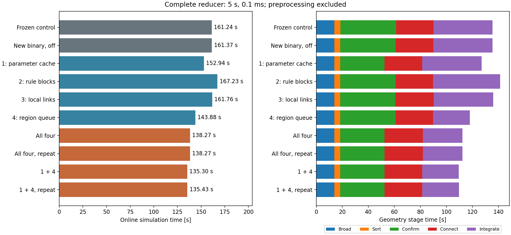
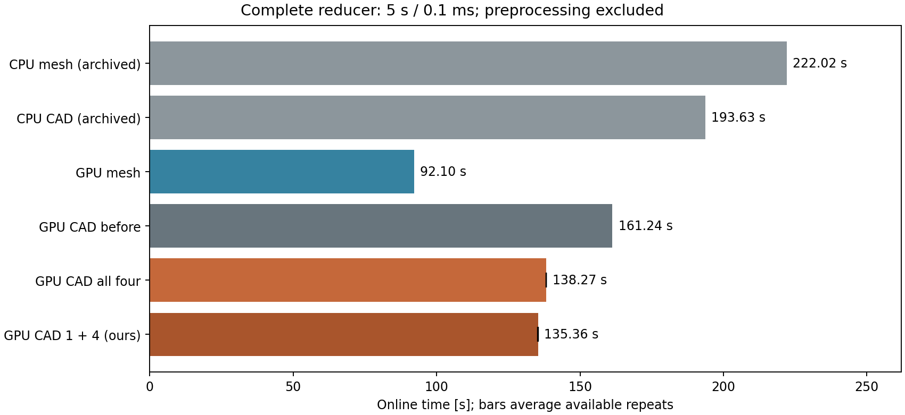
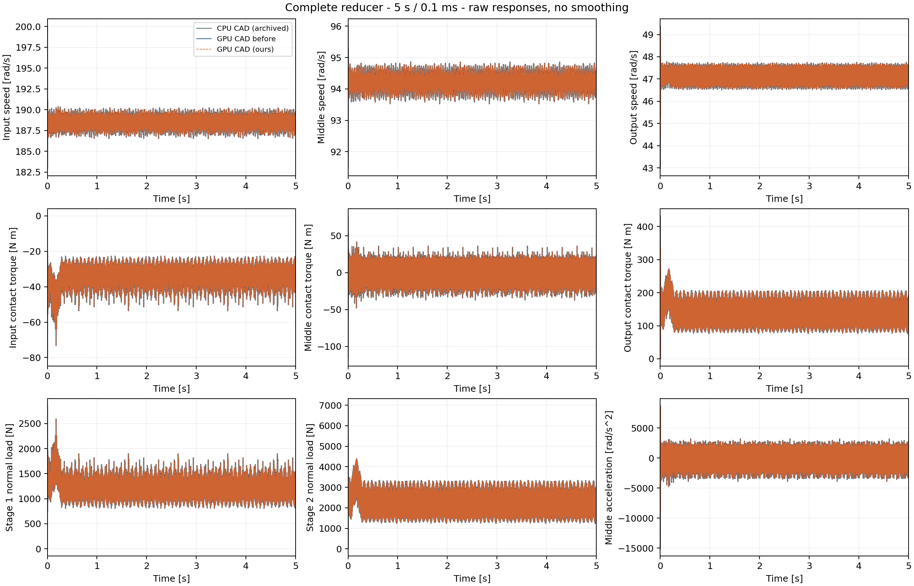
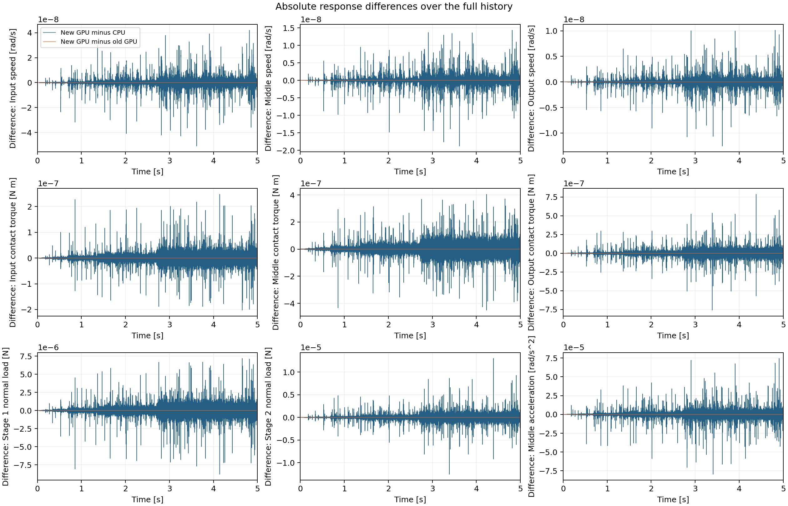

# Coherent GPU CAD scheduling

This experiment implements four optional scheduling and query-cache strategies
on the frozen compiled-CAD rigid-contact backend. The final comparison uses the
same reducer, 5 s duration, 0.1 ms main step, shared penalty stiffness and HHT
spectral radius zero. Preprocessing, compilation and upload are excluded from
online timing. CPU performance references are archived, not rerun.

**All four strategies are implemented and tested.** On the local RTX 3070,
all four take 138.27 / 138.27 s. The faster measured combination,
strategies 1 + 4 (`--gpu-opt-mask 9`), takes **135.30 / 135.43 s**.
Its two-run average is 16.0% below the fresh frozen GPU CAD control and
30.1% below the archived CPU CAD measurement. The fresh GPU mesh run
takes 92.10 s. CAD remains slower than this mesh implementation and is not real time.

Hardware: RTX 3070 8 GiB, Ryzen 9 5900X, Windows, driver 610.88, CUDA 12.6,
sm_86, MSVC 19.44 Release, FP64 with FMA enabled. All formal runs execute
individually without concurrent GPU jobs or compilation. The CAD mode is
opt-in; the existing default schedule is unchanged.

## Strategies and controls

`--gpu-execution coherent --gpu-opt-mask N` selects a bit mask. The original
`wavefront` schedule remains available, and the default schedule is unchanged.

| Bit | Implemented strategy | Correctness constraint |
| --- | --- | --- |
| 1 | Retain both material-exit UVs; use the previous knot intervals and their immediate neighbors to locate the same polynomial for canonical Newton iterates. Mark duplicate source proposals before projection. Evaluate the first 32 candidates in parallel, and evaluate the remaining candidates only when the first batch contains no accepted hit or error. | Preserve the original projection start, polynomial arithmetic, candidate priority and witness. A cache miss uses the original grid lookup. |
| 2 | Precompute position and normal bounds for 4 x 4 groups of the original 12, 24, 48 and 96 order quadrature grids. At each pose, enclose their finite ray segments and test target face/span bounds. | Reject a block only when it cannot contribute to that region. Original points, weights and summation order remain. Diagnostic mode rechecks rejected valid points with complete GPU queries. |
| 4 | Precompute conservative chart neighborhoods and prioritize local connection proofs. | A neighborhood is an AABB overlap relation, not an assertion of shared topology or contact connectivity. Nonlocal edges and the complete geometric checks remain. |
| 8 | Give each body pair a bounded pool of four region workspaces, refill it as regions finish, and batch queries across regions and body pairs. Bucket rays by target chart using a warp prefix scan. | Scatter depths to their original quadrature indices and regions to their original component order. Every ray still checks the complete compiled geometry, including possible nearer surfaces. |

The pool size limits simultaneous jobs, not the number of supported contact
regions. The five-pad regression exercises slot refill. All online decisions
and geometry queries remain on GPU; there is no online OCCT fallback, gear
formula, stored trajectory or load map.

## Rejected prototype and synchronization repair

Directly using a warm-start projection as the new contact witness was rejected.
In the reducer diagnostic it changed the first pair from one region to two at
step 82 (8.2 ms), followed by a maximum normal-load discrepancy of about 639 N
over the 500-step diagnostic. A different valid witness can change the outcome
of the bounded connection search. The accepted candidate design therefore
uses prior parameters to accelerate *span lookup*, while retaining the
canonical witness. This is a numerical-regression finding, not independent
evidence that either alternative contact partition is physically correct.

The first safe-parameter build passed numerical, synchronization, memory and
initialization checks, but racecheck reported writes to the shared search-audit
witness without a memory-ordering barrier between a failed prior attempt and
the next proposal. `Query::find` now places a warp barrier before broadcasting
the prior result. A register shuffle alone does not order shared stores.
Failed records are retained; they are not counted as successful checks.

## Numerical and timing verification

Every CAD run completes 50,000 main steps and 50,001 frames. All full
response files have SHA-256
`8b4fdf24d2d3a4614e1ca2f11bf3982036e6d1d493d07c578ed1cc3ab144437c`.
The complete response, both contact flags, switching indices and raw adjacent
increments are identical to the frozen GPU control. No response smoothing,
resampling or force-error tolerance relaxation is used. CPU timing is not rerun.

| GPU CAD configuration | Online time [s] | Time reduction vs control |
| --- | ---: | ---: |
| Frozen GPU CAD control | 161.24 | +0.0% |
| New binary, all options off | 161.37 | -0.1% |
| 1: parameter cache / ordered candidates | 152.94 | +5.1% |
| 2: quadrature block culling | 167.23 | -3.7% |
| 3: local connection ordering | 161.76 | -0.3% |
| 4: pooled regions / chart batches | 143.88 | +10.8% |
| All four | 138.27 | +14.2% |
| All four, repeat | 138.27 | +14.2% |
| 1 + 4 (ours, selected) | 135.30 | +16.1% |
| 1 + 4, repeat | 135.43 | +16.0% |

The mean of the two selected runs is **135.36 s**, versus 138.27 s for
all four. Keep all strategies available for ablation; explicitly select mask 9
for this measured workload. A single reducer does not establish that this
selection is fastest on every geometry.

- Strategy 1 lowers confirmation time from 42.76 to
  34.23 s. The direct warm-witness prototype was rejected;
  accepted reuse only accelerates knot-span lookup, plus ordered candidate work.
- Strategy 2 lowers ray count from 105,669,028 to
  77,764,556, but its extra checks increase integration
  time from 45.27 to 51.53 s.
  Reduced work count alone is not a performance improvement.
- Strategy 3 changes connection ordering but provides no measured wall-time
  benefit here. It retains complete geometric connectivity checks.
- Strategy 4 lowers integration time to 28.24 s by
  reducing query batches from 164,173 to
  67,618; its ray count remains unchanged.

| Backend | Online time for 5 s | Evidence |
| --- | ---: | --- |
| CPU Gmsh mesh, four workers | 222.02 s | Archived, not rerun |
| CPU compiled CAD, four workers | 193.63 s | Archived, not rerun |
| GPU mesh | 92.10 s | Fresh full run |
| GPU CAD before | 161.24 s | Fresh frozen-executable control |
| GPU CAD all four | 138.27 / 138.27 s | Two full runs |
| GPU CAD 1 + 4 (ours) | 135.30 / 135.43 s | Two full runs |

Mesh and CAD share the model, loads and integration settings, but use different
contact geometry and support construction. The GPU mesh's known sampled region
and load discrepancies remain documented in the [mesh report](../gpu-mesh-dynamics/README.md).
These timings do not establish equal physical accuracy. GPU-to-CPU CAD response
agreement is also implementation agreement, not an independent physical proof.






The nine raw curves show three shaft speeds, three contact torques, both normal
loads and the middle-shaft acceleration. The optimized curve overlays the old
GPU curve exactly. Remaining phase times are in [the selected report](selected/comparison.json);
confirmation, connectivity and integration still require substantial work.
The selected run misses every 0.1 ms deadline, so throughput and per-step real
time remain unachieved.

Native CPU/CUDA regressions pass, including disconnected pads, independent
pairs, split faces, optional missing low-order quadrature caches and refill of
a four-slot pool with five regions. Every individual strategy and all-four
mode are exercised on generic fixtures. Full production-graph diagnostics for
both mask 15 and mask 9 pass unfiltered racecheck, synccheck, memcheck and
initcheck with zero reported errors; racecheck also reports zero warnings.
These are 50-step diagnostics with same-pose geometry audits, separate from
full-duration numerical/timing runs. Synccheck/memcheck/initcheck use Compute
Sanitizer 2026.4; racecheck uses 2024.3 because the newer racechecker has the
previously recorded host-tool failure. Native tests were not rerun for mask 9:
the runtime and test executable hashes are identical to the all-four checks.

Evidence: [all full-run comparisons](ablations.json),
[backend timings](backend-comparison.json), [all-four checks](checks/checks.json),
[mask-9 checks](checks-9/checks.json), [source and binary hashes](source-manifest.json),
[rejected direct-witness prototype](rejected-warm-witness.json),
[rejected pre-barrier racecheck](rejected-race-checks/checks.json).
The 500-step parameter diagnostics use the pre-barrier, arithmetic-identical
build; final full-duration comparisons and final graph checks use the fixed binary.

## Reproduction

Build the Release runtime and native tests with CUDA columns enabled. Use the
[frozen scene and compiled parts](../cpu-bezier/standalone/reducer-inputs.zip).

```text
nc_contact_runtime SCENE 0 0.0001 5 1 response --method cad-compiled --device cuda-resident --solver penalty --penalty-stiffness shared --geometry-update predictor --spectral-radius 0 --gpu-execution coherent --gpu-opt-mask 15 --region-reduction ordered
```

Use `--gpu-opt-mask 9` for the measured faster combination. Run masks 0, 1,
2, 4, 8, 9 and 15 separately for the controls and ablations. Each
run is bounded to 1,800 s by
[`cad_gpu_execution.py`](../../../benchmarks/aes/cad_gpu_execution.py).
[`report_cad_coherent.py`](../../../benchmarks/aes/report_cad_coherent.py)
checks complete histories and records every difference before plotting timings.

The supported geometry, joint coordinates and force laws remain those of the
existing resident backend: supported analytic and polynomial bicubic charts,
up to 16 scalar hinge/prismatic coordinates, and frictionless penalty contact.
The immutable compiled parts are unchanged and retain their separate
[source-to-runtime geometry audit](../cpu-bezier/standalone/README.md#source-to-runtime-geometry-check).

## Last verified against

Source: `src/cuda_coherent_prepare.cuh`, `src/cuda_batched_contact.cuh`,
`src/cuda_resident_geometry.cuh`, `src/cuda_columns.cu`,
`tests/compiled_cad.cpp`. Native CPU/CUDA regressions, unfiltered production diagnostics and ten full
CAD runs plus one mesh run completed on 2026-11-28. Exact commands are recorded
in the run/check JSON files. The wiki-audit script is absent; documentation
links and `git diff --check` are checked directly.

Documentation update summary:

- Updated: root `README.md`, `wiki/ContactDetection.md`,
  `wiki/RigidContactBackend.md`, and this evidence page.
- Based on: the source files and complete run/check records linked above.
- Checks: native CPU/CUDA regressions, final graph diagnostics, full response
  comparisons, Python figure inspection, documentation links and Git whitespace checks.
- Not verified: other GPUs/toolchains, full-duration sanitizer instrumentation,
  real-time performance, or equal physical accuracy with the GPU mesh model.
- `AGENTS.md`: unchanged.
