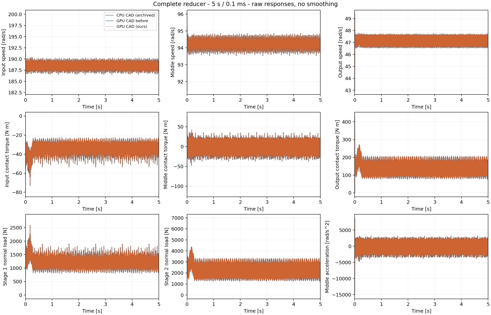

# Whole-graph synchronization verification

The conditional CAD phase schedule passes unfiltered whole-graph synccheck
after replacing cross-warp barriers with warp-scoped work. This is a scheduling
fix, not a change to contact geometry or a claim of real-time performance.

## Change

`batch_enabled` broadcasts one decision within each full warp. Sorting and
nonqueued candidate confirmation now use 32-thread blocks; their shared state
is consumed only by that warp. Candidate lists of 33-1,024 entries are sorted
as independent 32-entry tiles, then merged by parallel rank queries against
those sorted tiles. Equal entries use their tile-array positions as a tie
break, giving distinct output ranks. A graph dependency separates reads of
the completed tiles from writes to a second candidate array. Group assembly
swaps arrays only after the merge finishes. Other list sizes retain the
complete sorting network; no candidates are dropped at the dispatch threshold.
After merging, one warp collectively loads the sorted face IDs into an 8 KiB
shared array for the ordered group scan. The scan reads those integer IDs
instead of issuing a serial sequence of global-memory reads. Candidate data
and the group order are unchanged.
Each tile needs 1 KiB of shared memory. Both global arrays retain full workspace
capacity so a later pose may safely grow beyond the merge threshold. The
second array costs 2 MiB per workspace (6 MiB for this reducer).
Independent 128-thread task-generation blocks keep four independent warps.
Candidate ordering, quadrature columns,
geometry equations, force laws and integration settings are unchanged.

The change applies to both `batched` and `wavefront`. Other schedules and the
default remain unchanged. There is no host decision inside the device loop,
no online OCCT fallback and no model-specific code.

## Isolated trigger

The [standalone reproducer](../../../benchmarks/aes/cuda_graph_sync/README.md)
runs shared-memory exchanges without CAD or dynamics. Flat and IF graphs pass
with block barriers. The WHILE block-barrier case reports a divergent-warp
error. WHILE cases with full-warp synchronization pass with both 32 and 128
threads. An intentionally invalid runtime warp mask is rejected.
[Commands and outcomes](probe/checks.json).

The initial constant-mask negative control compiled without a warp barrier;
it was replaced with a runtime mask and rerun. A zero-error report for code
whose barrier has been removed is not evidence that the checker recognizes
invalid barriers. NVIDIA documents the scope of warp-mask validation in the
[synccheck reference](https://docs.nvidia.com/compute-sanitizer/ComputeSanitizer/index.html#understanding-synccheck-reports).

These observations locate a WHILE/block-barrier interaction; they do not
establish a vendor-confirmed CUDA defect. The runtime change avoids that
interaction using synchronization appropriate to its actual data dependencies.

## Production checks

The [old executable](before.json) failed with
[289 synchronization errors](before-synccheck.log). The new executable passes:

| Check | Workload | Result |
| --- | --- | --- |
| Native CPU/CUDA | Analytic contacts, release, independent pairs, disconnected pads, partitioned faces and curved rays | Pass |
| Candidate-sort dispatch coverage | One / three disjoint box contacts produce 512 / 1,536 candidates; compare against the cached schedule | Pass |
| Synccheck, `wavefront` | Complete production graph, 50 reducer steps, audit reduction | 0 errors |
| Synccheck, `batched` | Complete production graph, 50 reducer steps, audit reduction | 0 errors |
| Synccheck, native CUDA suite | All schedules, including the analytic cases above | 0 errors |
| Memcheck, `wavefront` | Complete production graph, 50 reducer steps, audit reduction | 0 errors |
| Initcheck, `wavefront` | Complete production graph, 50 reducer steps, audit reduction | 0 errors |
| Racecheck 2024.3, `wavefront` | Same complete production graph, 50 reducer steps, audit reduction | 0 errors, 0 warnings |

[Exact commands, return codes and binary hashes](checks.json) ·
[Build configuration and source hashes](build.json).
No kernel filters, error suppressions or alternate schedule are used for the
production checks. The reducer diagnostic audits 124,524 resolved rays and
2,085 candidate groups at their actual trial poses. The native cases exercise
the deferred-query path as well. These are bounded diagnostics, **not five
seconds of sanitizer instrumentation**. Complete uninstrumented five-second
response and timing records are kept separately.

Racecheck **2026.4.0.0**, distributed in CUDA sanitizer package **13.5.25**,
terminated abnormally under its default analysis workers,
under one worker, and in the native CUDA test suite. Zero displayed hazards in
those failed processes are **not passes**. The same production binary, scene,
50-step graph and audit mode completed successfully under the **2024.3.0.0**
racechecker shipped with CUDA 12.6, without kernel filters or suppressed errors.
[Rejected 2026.4 runs on the shared-array trial](racecheck-13.5-failures.json) and
the [tiled-merge trial failure](racecheck-current13.5-failure.json) are retained
with their binary hashes and logs.
The cause of that version-specific diagnostic failure has not been established;
no claim of a vendor-confirmed defect is made. Synccheck, memcheck and initcheck
use 2026.4 and pass; the accepted racecheck uses 2024.3. The exact tool-version
output is recorded in `checks.json`; 13.5.25 in artifact filenames identifies
the downloaded package, not the checker's reported version.

## Rejected performance regression

The first warp-only revision passed synchronization and reproduced all 50,001
response frames, but its complete online time increased to **176.57 s**.
Sorting rose from 6.91 s to 16.87 s because the single warp repeatedly accessed
the global candidate array. This led to the shared-memory staging change;
the first revision is not presented as the final performance result.
[Intermediate run](warp-only-run.json) · [Intermediate source/binary hashes](warp-only-build.json).

Moving that single-warp network into a 32 KiB shared array was insufficient:
the complete run took **175.75 s**, with 16.28 s in sorting and an identical
response. [Run](staged32-run.json) · [Build](staged32-build.json).
Padding its records improved the isolated sorting time by only about 10% at
664 entries, so that layout trial was not applied.
[Layout trial](sort-layout-trial.txt).

An isolated comparison then tested the tiled rank merge against the shared
network, using CPU `std::sort` as the ordering reference, repeated entries,
seven list sizes, two candidate lists and 1,000 graph repetitions. At 664 entries,
291.87 ms fell to 45.03 ms. Very short lists did not benefit, motivating the
lower dispatch threshold. These are sorting microbenchmarks, **not complete
simulation timings**. [Source](sort-microbenchmark.cu) · [Measurements](sort-microbenchmark.txt).

The tiled-merge trial then completed five seconds in **171.48 / 171.78 s**,
with 11.83 s in sorting/group assembly and identical complete responses.
The remaining ordered group scan still read individual face IDs from global
memory. This motivated the collective key-loading change described above.
[Trial run](merge-run.json) · [Repeat](merge-repeat.json) · [Build](merge-build.json).

## Complete five-second results

The final version completed two independent **5 s / 0.1 ms** simulations in
**164.76 s and 164.73 s online**. The complete response files match the trusted
GPU reference byte for byte: 50,001 frames, including all contact flags,
coordinates, speeds, accelerations, loads and generalized forces. The 44
subdivisions, 185,780 force evaluations and 105,669,028 ray queries are unchanged.
This revision changes scheduling and memory access, not physical accuracy.

| Version | Online time, s | Whole-graph synccheck |
| --- | ---: | --- |
| Archived CPU CAD, four workers | 193.63 | Not applicable |
| Previous GPU query pipeline | 163.39 / 163.49 | Failed |
| Warp-only trial | 176.57 | Passed bounded diagnostics |
| Tiled merge without collective group keys | 171.48 / 171.78 | Passed bounded diagnostics |
| Final GPU CAD (ours) | **164.76 / 164.73** | **Passed bounded diagnostics** |

The final version is about 0.8% slower than the previous GPU record and about
14.9% lower in online time than the archived CPU result. This resolves the
synchronization-check failure while retaining the preceding performance scale;
it does not establish a new substantial GPU speedup. The CPU was not rerun.
Setup, compilation and output-file serialization are excluded from online
timing; final device synchronization and output download are included.

| Recorded phase | Previous GPU, s | Final GPU, s |
| --- | ---: | ---: |
| Candidate generation | 13.89 | 14.20 |
| Candidate sorting and face-pair grouping | 6.91 | **4.76** |
| Contact confirmation | 42.67 | 43.68 |
| Connected-region construction | 28.83 | 29.46 |
| Pressure integration | 45.31 | 46.29 |
| Force/moment reduction | 0.95 | 0.95 |

The collective face-key load reduced sorting/group assembly from 11.83 s in
the tiled-merge trial to 4.76 s. Other phases and graph/integrator overhead still
dominate. Median and 99th-percentile main-step times are 3.108 ms and 5.051 ms;
all 50,000 steps exceed the 0.1 ms deadline. **Real-time performance remains
unachieved.** These are single-reducer performance measurements, not an
all-model throughput guarantee.

The separate 500-step same-pose audit checks 963,668 precomputed queries and
16,394 candidate groups. All nine force/moment component error maxima are zero.
Against the archived CPU response, the maximum speed, normal-load and contact-
torque differences remain 5.10e-8 rad/s, 1.31e-5 N and 7.87e-7 N m. Both contact
flags and their switch frames agree. No smoothing or temporal interpolation
is used.

[Run](run.json) · [Repeat](repeat.json) · [Acceptance](acceptance.json) ·
[Unchanged work counts](work-counts.json) · [Raw response comparison](comparison.json) ·
[Same-pose errors](same-pose-summary.json) · [Curves](responses.png) ·
[Signed differences in physical units](differences.png) · [Timing](timing.png) · [Curve data](response.npz).



## Reproduction and scope

Use the existing [frozen scene/parts](../cpu-bezier/standalone/reducer-inputs.zip),
Release CUDA build with `NC_CUDA_FMA=ON`, and the exact sanitizer commands in
`checks.json`. The four part hashes still match the
[source-to-runtime equivalence audit](../cpu-bezier/standalone/part-equivalence.json);
no chart, trim or precompiled model changed in this revision.

```text
nc_compiled_tests
nc_compiled_tests --cuda
python benchmarks/aes/cad_gpu_execution.py EXE SCENE AUDIT --step .0001 --duration .05 --execution wavefront --reduction audit
python benchmarks/aes/cad_gpu_execution.py EXE SCENE RUN --step .0001 --execution wavefront
python benchmarks/aes/report_cad_segments.py BEFORE RUN CPU SCENE REPORT --require-identical
```

Hardware: RTX 3070, Ryzen 9 5900X, Windows driver 610.88; CUDA 12.6.20,
sm_86, Compute Sanitizer 2026.4.0.0 (racecheck: 2024.3.0.0). The check claim is for this tested build.
It does not certify other driver/toolchain combinations. Timing runs are
individual processes with a 1,800-second limit; preprocessing is excluded,
while final synchronization and output download are included. No CPU
performance benchmark is rerun. Current supported-chart, 16-coordinate and
frictionless penalty-solver limits remain; no broader CAD or solver support
is inferred from this scheduling change.

Documentation update: `README.md`, `wiki/ContactDetection.md` and
`wiki/RigidContactBackend.md` describe the implementation in
`cuda_batched_contact.cuh`, `cuda_resident_geometry.cuh` and `cuda_columns.cu`.
Commands and hashes for the verified native/diagnostic/full-history checks are
linked above. Other hardware, a full-duration sanitizer run and real-time
performance have not been verified. `AGENTS.md` is unchanged.
