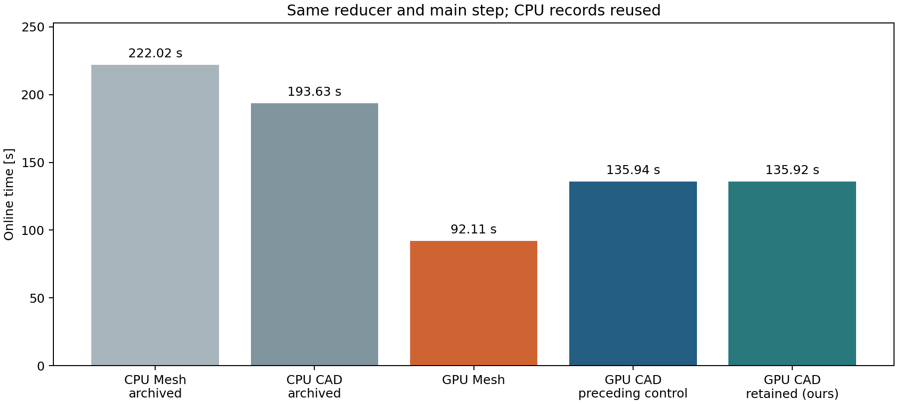
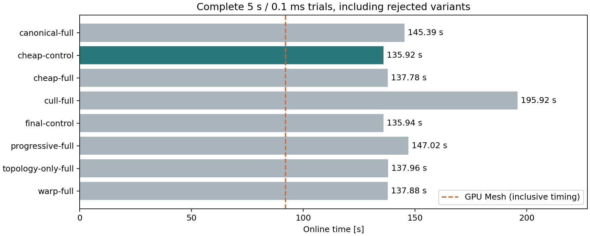
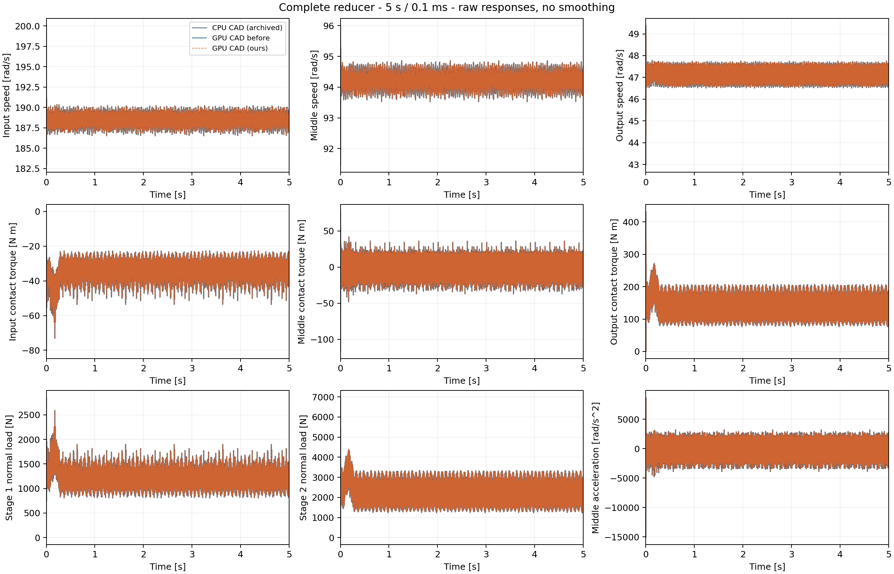

# Ordered candidate batches, CAD topology and projection reuse

The new performance experiments did **not** improve the retained mask-9 CAD
backend. Candidate batching and true shared-edge metadata are implemented;
robust witness-independent discovery/partitioning and production warm starts
remain unfinished. Mask 64 is diagnostic-only and rejected in production
mode. No mesh-parity or real-time claim is supported.

## Complete runs

Same reducer, **5 s / 0.1 ms / 50,000 main steps**, RTX 3070 8 GiB,
Ryzen 9 5900X, driver 610.88, CUDA 12.6, sm_86, Release FP64/FMA.
Both backends time graph launch through final status/response download.
Preprocessing, upload and file export are excluded. Formal runs were sequential,
without another GPU job or compilation; each had a 1,800 s limit.
CPU performance records were reused without rerunning them.

| Method / experiment | Online time | Numerical status |
| --- | ---: | --- |
| CPU Mesh, archived | 222.02 s | Existing CPU reference |
| CPU precompiled CAD, archived | 193.63 s | Existing CPU reference |
| GPU Mesh, fresh | **92.11 s** | All values identical to the preceding Mesh run |
| GPU precompiled CAD, retained (ours), mask 9 | **135.92 s** | All 50,001 reference frames byte-identical |
| Ordered 32-wide groups + cheap bounds, mask 25 | 137.78 s | Byte-identical; performance regression |
| Above + original CAD topology proposals, mask 57 | 137.96 s | Byte-identical; no topology bridge used |

These are execution-cost and regression comparisons. They do not establish
equal physical accuracy between Mesh and CAD. Existing Mesh/CAD modelling
differences are not removed by this experiment. CAD is 47.55% slower than the
fresh Mesh run; every CAD main step still exceeds its 0.1 ms deadline.



The same final executable was used for the retained mask 9 and masks 25/57.
Its SHA-256 is `411a82ab8a5d8bfbe663fdc8d6b88a89a90c9301d2572e1618fc9710199adb97`.
The preceding same-algorithm control took 135.94 s. The older two mask-9
measurements were 135.30 / 135.43 s; the latest run is not a new speedup.

## What changed and why it did not help

| Quantity | Retained mask 9 | New mask 25 | New mask 57 |
| --- | ---: | ---: | ---: |
| Unique candidate proposal Newton calls | 14,264,081 | 10,842,620 | 10,842,620 |
| Proposals rejected before Newton | 0 | 3,421,461 | 3,421,461 |
| Later-batch projections avoided | 0 | **0** | **0** |
| Executed projections after the winning candidate | Not instrumented | 745,815 | 745,815 |
| Candidate confirmation | 34.28 s | 36.42 s | 36.45 s |
| Contact-region connectivity | 29.02 s | 28.91 s | 28.94 s |
| Region integration | 28.19 s | 28.12 s | 28.15 s |
| Production topology bridge checks / successes | 0 / 0 | 0 / 0 | **0 / 0** |

Most evaluated groups fit in one warp-sized batch. The early-stop mechanism
therefore avoids no later batches in the final reducer experiment. Cheap
bounds remove 24.0% of candidate Newton calls but add their own work; the
measured confirmation phase is slower. This is direct evidence that minimizing
projection count alone does not minimize elapsed time. The instrumentation
does not yet separate instruction cost, occupancy and load imbalance well
enough to attribute the remaining slowdown to one of them.

The 2,492 original shared CAD edges are available on GPU. However, the
production link search accepts a direct path or rejects unrelated faces
without reaching a useful shared-edge bridge on this reducer. No connectivity
speedup may be attributed to the new metadata. An intrusive short-run profile
places most sampled connection work in complete segment-inside-solid checks;
its sums are work totals, not exclusive wall-clock phases, and it is not a
formal timing result.

## Implemented scope

- **Bit 16:** independent warp-local groups, batches of 32, original candidate
  order, early stop after the earliest accepted result/error. Whole-face AABB
  and precompiled OBB tests enclose both positive and negative projection
  depths before rejecting a candidate. Negative depths still drive local
  refinement. Requires bit 1.
- **Bit 32:** read original `TrimCurve.feature/start/end` incidence from all
  trim loops, including rectangular charts. Exactly two incident faces allow
  an edge hint. Three precompiled positions per curve piece propose a bridge;
  complete current-pose chord and segment tests in both solids must accept it.
  Static adjacency alone never merges regions. Missing/nonmanifold incidence
  retains the existing GPU query path. This is a positive path proposal,
  **not a complete moving contact-boundary algorithm**.
- **Bit 64:** experimental prior-target-UV Newton start, cold retry on failure,
  and fixed material-normal ray confirmation. Requires bits 1 and 32 and
  `--region-reduction audit`. Normal production use throws an explicit error.
- **Bit 128:** optional deeper span-BVH pre-cull; requires bit 16. Retained for
  ablation, not recommended by the reducer timings.

No online CPU/OCCT geometry fallback, gear formula, trajectory cache or force
map was added. Existing geometry, workspace and solver restrictions still
apply. The measured production choice remains **mask 9**; defaults are unchanged.

`projection_attempts` counts unique candidate proposal Newton calls, not prior
seeds or local refinement. `avoided_projections` compares future batches with
the preceding two-batch implementation. `unused_projections` counts actual
Newton calls after the winner in an already executed batch. Audit runs also
execute independent reference queries, so their counts must not be compared
with production counts as performance measurements.

## Warm reuse is not accepted

The same-pose audit first found witness differences; allowing an alternative
witness only after an independent interior connection check exposed a stronger
problem. At step 82 (reported time 0.0081 s), pair 1, faces (117, 33), prior-UV
Newton found contact while the original start missed it. The detected depth
was 0.000530949 mm, about 0.531 micrometres. This is a face-membership change,
not merely different coordinates for the same witness.

The audit failure does not prove that the warm hit is false or that the cold
miss is correct. Independent geometry and region-membership checks are still
required. Silently returning the cold result would hide this issue. The
current diagnostic guard prevents this experiment from changing production
loads. The final frozen build reproduces the same step-82 failure; see the
[final warm-audit log](runs/final-warm-audit/console.log).

A preceding canonical-witness prototype completed 5 s but changed the
trajectory near 2.9646 s: maximum stage-1 load difference 34.18 N, middle
contact-torque difference 1.81 N m and middle-speed difference 0.0169 rad/s.
It also added one integration subdivision. Contact flags alone did not expose
these changes. Its [raw histories and differences](canonical/comparison.json)
are retained; it is not an accepted optimization or a higher-accuracy result.

## Rejected performance trials

| Frozen prototype | Online time | Result |
| --- | ---: | --- |
| Global graph rounds, first 8 then 32 candidates | 147.02 s | 548,494 avoided proposals, response unchanged, slower |
| Warp-local rounds, first 8 then 32 | 137.88 s | Response unchanged, still slower |
| Canonical witness + topology prototype | 145.39 s | Changed response; not accepted |
| Deep span-BVH candidate pre-cull, first 8 then 32 | 195.92 s | Fewer Newton calls but much more bound work; response unchanged |

Prototype bit meanings differ from the final build: in the canonical prototype,
bit 32 also canonicalized the witness. Final bit 32 only enables topology
proposals; canonicalization is isolated in diagnostic bit 64. Each record
includes its executable hash and exact command.



## Response verification

The final mask-9, mask-25 and mask-57 responses share SHA-256
`8b4fdf24d2d3a4614e1ca2f11bf3982036e6d1d493d07c578ed1cc3ab144437c`.
All 50,001 timestamps, contact flags, switching indices, raw responses,
adjacent increments and peak times are compared. No interpolation or smoothing
is used. Native analytic fixtures separately exercise contact/release,
disconnected pads, split charts, multiple bodies and up to 16 coordinates.
The topology-enabled fixture audit exercises 123 successful bridge proposals.
These checks demonstrate numerical regression, not independent physical accuracy.



[Full comparison](progressive-topology/comparison.json) ·
[Raw CAD data](progressive-topology/response.npz) ·
[Retained CAD response](selected/response.npz) ·
[Mesh response](mesh-response.npz) ·
[Experiment records](experiments.json)

## Diagnostics and reproduction

Native CPU/CUDA tests and the 500-step mask-57 same-pose audit pass. Full
production histories are verified separately from the bounded sanitizer runs.
All whole-graph diagnostics cover 50 steps, not the full 5 s history.

| Check | Configuration / tool | Result |
| --- | --- | --- |
| Native CPU/CUDA | Final runtime, coverage test executable | Pass, including 123 successful topology proposals and the production warm-mode guard |
| Synccheck / memcheck / initcheck | Mask 57, audit graph, 2026.4 | Pass, zero reported errors |
| Synccheck, analytic native CUDA suite | 2026.4 | Pass |
| Racecheck | Retained mask 9, audit graph, 2024.3 | Pass, zero hazards |
| Racecheck | Mask 57, audit graph, 2024.3 | Abnormal exit 3221226356; not a pass |
| Racecheck | Mask 57, audit graph, 2026.4 | Abnormal exit 3221225477; not a pass |
| Racecheck | Mask 57, ordered production graph, 2024.3 | Abnormal exit 3221226505; not a pass |
| Racecheck | Mask 25, ordered production graph, 2024.3 | Abnormal exit 3221225477; not a pass |

The failing racechecker logs end with zero displayed hazards but report an
unsuccessful target process. The nonzero exit makes them failed diagnostics.
The control passes and both new progressive variants fail under instrumentation;
the cause is not established as either a tool bug or an application defect.
The new progressive path is therefore **not fully sanitizer-validated** and
remains an optional experiment, in addition to its measured performance
regression. Do not report all checks as passed. Exact logs and commands are in
`checks/`; no filtered-kernel pass substitutes for these whole-graph results.

Run from the repository root, with the runtime and test executable built using
`NC_WITH_CUDA_COLUMNS=ON` and `NC_CUDA_FMA=ON`:

```text
python benchmarks/aes/cad_gpu_execution.py RUNTIME SCENE RUN --duration 5 --step .0001 --execution coherent --opt-mask 9
python benchmarks/aes/cad_gpu_execution.py RUNTIME SCENE RUN25 --duration 5 --step .0001 --execution coherent --opt-mask 25
python benchmarks/aes/cad_gpu_execution.py RUNTIME SCENE RUN57 --duration 5 --step .0001 --execution coherent --opt-mask 57
python benchmarks/aes/cuda_graph_sync/production.py RUNTIME TEST SCENE SANITIZER CHECKS --execution coherent --opt-mask 57
python benchmarks/aes/report_cad_topology.py RUNS CONTROL RETAINED CPU_ARCHIVE SCENE OUTPUT
```

All formal commands, hashes and failures are retained in `runs/`. The source
and executable manifests identify the build used for each experiment.
[Verification manifest](verification.json) ·
[Original CAD topology counts](source-topology.jsonl).
Historical prototypes are records of separate frozen local executables;
their old bit combinations are not alternate modes of the final source.
