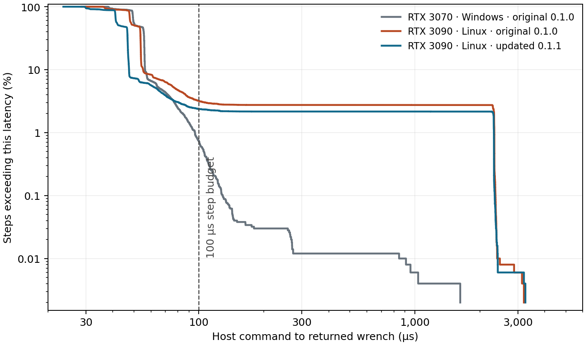

# 共享 RTX 3090 的逐步载荷交换

同一两级减速器、65,732 片 Gmsh 三角网格、同一几何表、载荷、力模型和广义 α 积分设置。每次计算 5 s，步长 0.1 ms，共 50,000 步。采用 `mesh-wrench --exchange`，主机取得当前步的两级载荷与力矩后才提交下一步，返回值与 GPU 同步保存的结果逐项核对。计时从初始动力学状态计算到取回全程响应，模型与缓存准备、结果压缩写盘另计。

## 原始差距

0.1.0 发布测试中，Windows RTX 3070 用时 2.706 s，Linux RTX 3090 用时 5.680 s。两者主机单步往返中位数分别为 51.30 和 50.45 µs。3070 有 3 步超过 1 ms，合计 0.0043 s。3090 有 1,371 步超过 1 ms，合计 3.1965 s。这里统计这些步的完整用时。3090 从设备端记录到 1,174 个超过 1 ms 的步，其中 1,079 步直接命中缓存或预选面片，同一模型两张卡的逐步 Newton 迭代次数完全相同。

复测时，服务器上已有另一个 GPU 计算进程，单独测量前 GPU 利用率为 100%。一个没有主机往返、没有几何查询、只读取设备时钟的内核运行了 400 ms。相邻读数间出现 92 次超过 100 µs 的空档，中位 2.273 ms，合计 209.16 ms。服务器上原版往返超过 1 ms 的步中位用时为 2.331 ms。观测与共享 GPU 调度造成的等待相符。独占 3090 的耗时未测量。Windows 本轮另测的时钟内核也观察到了间歇停顿，两次发布测试的机器负载可能不同。



## 改动与复测

| 服务器逐步交换配置 | 5 s 在线耗时 |
|---|---:|
| 原版，每接触对 4 个 warp，每次启动推进 256 步 | 5.683 s |
| 每步并行读一次主机载荷，在 GPU 共享内存中供 Newton 迭代复用 | 5.054 s |
| 上一项，每接触对改用 2 个 warp | 4.884 s |
| 上一项，每次启动推进 1,024 步，新版安装包五次中位数 | **4.660 s** |

每次内核启动涵盖更多次独立握手，50,000 步的主机命令与应答次数均为 50,000。核验仍包含有限三角面相交及候选补搜。新版另测每接触对 1 个 warp 时用时 4.467 s，最慢主机步为 6.397 ms。默认选择 2 个 warp，在本次测量中缩短了最慢步。

| 平台及模式 | 原版整段复测 | 新版整段复测 |
|---|---|---|
| 服务器 RTX 3090，每步交换 | 5.679、5.676、5.682 s | 4.662、4.658、4.659、4.660、4.663 s |
| 本机 RTX 3070，每步交换 | 3.640、3.899 s | 3.391、3.267、3.369 s |

服务器两版交替运行，本机先运行原版，再运行新版。所有安装包复测在全部 50,001 个时刻核对轴角、轴速、两级传动误差、法向载荷和力矩，均与发布前保存的 GPU 轨迹逐项相等。服务器新版五次均满足整段在线用时小于 5 s。中位那次主机单步 P50、P95、P99 分别为 43.08、63.74、2,323.83 µs，1,183 步超过 100 µs，最慢 3.793 ms。逐步硬实时截止条件仍未满足。

## 复现

在 `1110-server2` 上运行已部署安装包，或从[发布页](https://github.com/W-Moorer/NurbsCONTACT/releases/tag/gpu-backend-v0.1.1)取得同版本。完整安装包测试使用相同的缓存，几何方法与步长均采用示例默认设置。

```bash
~/NurbsCONTACT/releases/gpu-backend-0.1.1/run-example.sh --exchange
```

从仓库根目录复核已保存的单步记录，随后可在本机 GPU 上独立测量设备时钟空档。

```bash
python benchmarks/aes/gpu_timer_gaps.py --response results/aes/gpu-hinge-mesh/latency/linux-0.1.0.npz
python benchmarks/aes/gpu_timer_gaps.py
python results/aes/gpu-hinge-mesh/latency/plot.py
```

[各次计时、调度探针及数值核对](measurements.json) · [原版 Windows 单步记录](windows-0.1.0.npz) · [原版 Linux 单步记录](linux-0.1.0.npz) · [新版 Linux 中位运行单步记录](linux-0.1.1.npz)
