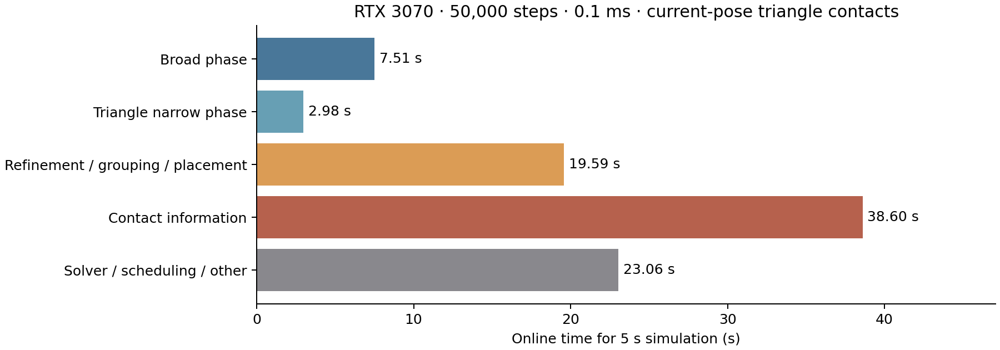
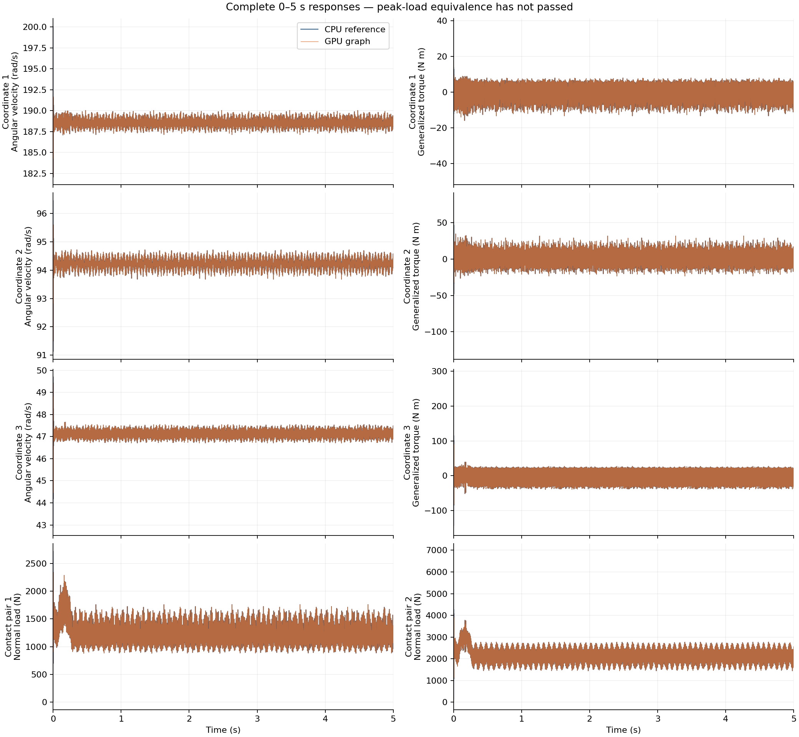
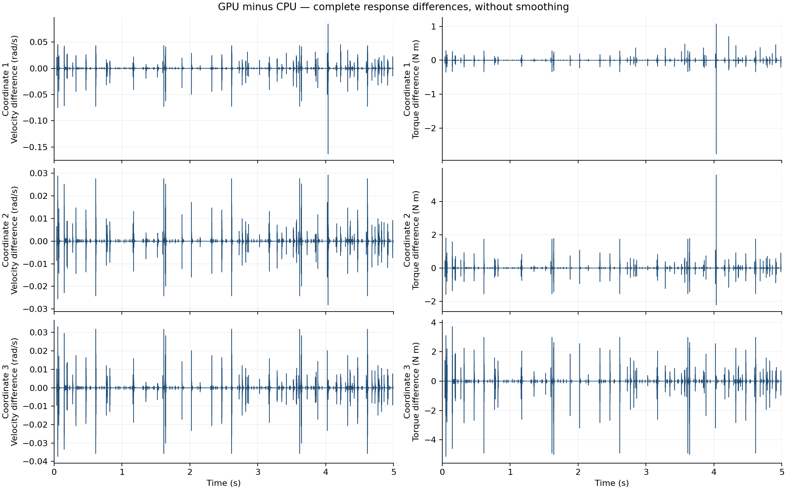

# Current-pose GPU mesh dynamics: performance and remaining accuracy gap

The same two-stage reducer advances **5 s in 50,000 main steps of 0.1 ms** on the local RTX 3070. Every online geometry query uses the current trial pose. No gear formula, future-trajectory cache, configuration-to-force table, CPU geometry call or per-step host load exchange is used. Preparation, topology construction, compilation and uploads are excluded from the online figures below.

This remains an **experimental backend**, not an accepted real-time or CPU-equivalent baseline. The source manifest, raw runs, complete responses and unresolved discrepancy are retained here. Historical CPU performance figures remain 222.02 s for mesh and 193.63 s for compiled CAD; they are not remeasured or relabeled by this experiment.

## Complete-run measurements

| Implementation | Online seconds | Comparison scope |
| --- | ---: | --- |
| Initial cooperative implementation, 8 blocks | 168.91 | Early implementation before frame correction; not an unchanged-response speed control |
| Cooperative implementation, 46 blocks | 103.28 | Parallel segment contributions and smaller solver matrices |
| Conditional graph before near-coplanar refinement | 89.40 | All 50,001 frames identical to the 103.28 s control; remaining false-positive triangle pairs |
| Refined predicate with shared-memory contour experiment | 122.44 | Rejects near-coplanar false positives and reports unresolved contacts |
| **Independent-kernel graph, retained contour accumulation** | **91.90 / 91.74** | **All 50,001 frames identical to the refined 122.44 s run** |

The last comparison changes GPU execution organization while preserving the complete response. The earlier 89.40 s result does not include the final near-coplanar refinement and is not substituted for the current result. Increasing the cooperative grid to 184 blocks also regressed to 149.61 s and was rejected.

[Initial run](first-full.json), [cooperative control](parallel-46.json), [earlier graph](graph-shared.json), [refined control](graph-filtered.json), [first final run](graph-final-verified.json), [repeat with block-uniform failure handling](final-run.json), [response hashes and errors](comparison.json).

The current run makes 100,178 body-pair geometry queries and 151,430 force evaluations, with 21 subdivisions. Its 99th-percentile main-step latency is 2.749 ms, versus a 0.100 ms real-time budget. The two runs used 154.48 s and 96.51 s of preparation respectively; both exclude it from online timing. The last run includes a block-uniform failure snapshot so an error reported by another block cannot make only some threads skip a block barrier.

| Current online stage | Seconds |
| --- | ---: |
| BVH traversal | 7.51 |
| Float rejection and initial FP64 triangle intersection | 2.98 |
| Placement, near-coplanar refinement and connected grouping | 19.59 |
| Contact information construction and publication | 38.60 |
| Remaining force, solver and graph scheduling work | 23.06 |
| **Total** | **91.74** |

The 10.49 s sum covers traversal and the initial triangle test; the additional plane-side refinement belongs to the next measured stage. It is not the full contact-force computation time. Likewise, the 23.06 s remainder is not an isolated integrator measurement. Device timestamps measure the four phases; wall time measures the complete graph. Nsight Compute hardware counters could not be collected (`ERR_NVGPUCTRPERM`); no counter-based stall diagnosis is claimed.



## What changed

The geometry replay's triangle detector is connected to the shared implicit solver through finite-feature and contour-ray contact construction. Instead of forcing every phase into one register-heavy cooperative launch, separate kernels handle broad phase, triangle filtering, intersection, placement, near-coplanar confirmation, grouping, support and the small Newton solve. GPU conditional WHILE/IF nodes decide substeps, geometry refresh and line-search continuation. Contact segment contributions are formed in parallel and accumulated in the original sorted-triangle FP64 order. Shared-memory contour batching increased resource use and was not retained.

The per-body-pair topology is independent of the mechanism: oriented face/edge/vertex adjacency, connected planar panels and straight ridges are prepared once. Dynamics currently supports the scalar hinge/prismatic scope documented in the [package API](../../../nurbscontact_gpu/README.md#current-pose-mesh-dynamics-experimental), not a full unconstrained multibody platform. The CPU and GPU both orthonormalize their relative rigid frames to prevent spurious axial scaling from opening a common end plane.

Near-coplanar confirmation uses a floating-point plane filter with a twofold fallback and an uncertainty margin. It does not claim exact arithmetic. The finite-feature solver reports status 27 when an intersecting component has neither a finite witness nor a zero-depth separation bound; enclosure and capacity overflow also report errors. Earlier strict checking stopped at 0.1531 s on a spurious isolated triangle pair; the added plane check rejects that false positive and allows the full run to finish.

## Response agreement and limitation

A corrected CPU trace was generated solely to verify the frame correction and the full response, not to replace archived CPU performance measurements. [Correctness-run command](cpu-verification.json) and [diagnostics](cpu-verification-stats.csv) are retained separately. The current and refined-control GPU traces have identical SHA-256 hashes. CPU/GPU contact presence agrees in both pairs at all 50,001 saved times.

| Quantity | RMS CPU/GPU difference | Maximum absolute difference |
| --- | ---: | ---: |
| Coordinate 1 angular velocity | 0.003240 rad/s | 0.163271 rad/s |
| Coordinate 2 angular velocity | 0.001218 rad/s | 0.029249 rad/s |
| Coordinate 3 angular velocity | 0.001577 rad/s | 0.037380 rad/s |
| Pair 1 normal load | 0.786716 N | 94.639298 N |
| Pair 2 normal load | 2.589558 N | 79.186614 N |

The early, unrefined same-pose audit found equal region counts but a maximum 84.4 micrometre contact-center discrepancy and 0.6005 micrometre depth discrepancy. At predictor pose 47, two extra GPU triangle hits changed a contour-weighted center; one nominal end-cap triangle has vertex heights `0.01600000000000002, 0.016, 0.016 m`. [Diagnostic](near-coplanar-diagnostic.json) and [unrefined audit](geometry-audit-before-filter.json). Refinement reduces full-history load RMS errors from about 7.76/24.20 N to 0.79/2.59 N, but the remaining peak differences prevent claiming CPU equivalence. No smoothing is applied.

A second diagnostic uses predictors from 154 saved states (308 body-pair queries), adding the largest full-response errors and neighboring steps to the regular sampling. It finds **9 region-count mismatches**, each CPU 4 versus GPU 3 in the second pair. When region counts agree, maximum point/normal/depth discrepancies are `1.21e-15 m / 4.03e-14 / 1.87e-17 m`; these small values do not cover the mismatched groups. The remaining issue is therefore contact partitioning, not a claim of uniformly accurate forces. [After-refinement audit](geometry-audit-after-filter.json) · [Mismatched predictors](region-count-discrepancies.csv). An extra plane-side check on shared edges did not remove these nine mismatches and was not retained.





[Compressed full response arrays and column names](responses.npz). The plots preserve the entire time interval, including startup; they do not replace long-time verification with a short selected window.

## Reproduction

**1 ms step experiment:** the unchanged backend was also asked to advance 5 s with a 1 ms main step. Two attempts stopped after saving 0.005 s, with unresolved finite contact information (status 27). Partial startup responses differ substantially from the 0.1 ms trace. There is no completed-run timing or valid long-time speedup for 1 ms. See the [attempt, repeat, curves and failure analysis](step-1ms/README.md).

Use the [original input deck](../cpu-foundation/reducer-physics/cpu-deck.zip). Supply the extracted `common-200.scene` with its relative Gmsh paths intact. Scene and mesh SHA-256 digests are recorded in every run JSON. Run only one GPU simulation at a time.

```text
python benchmarks/aes/mesh_bvh_dynamics.py path/to/common-200.scene run --duration 5 --step 0.0001 --blocks 46 --execution graph
python benchmarks/aes/mesh_bvh_dynamics.py path/to/common-200.scene control --duration 5 --step 0.0001 --blocks 46 --execution cooperative
python benchmarks/aes/compare_mesh_dynamics.py cpu.csv run/response.npy run/run.json comparison
python -m unittest discover -s tests -p test_gpu_mesh_dynamics.py -v
```

`--cpu-trace ... --cpu-query nc_mesh --audit-only --predictor-audit` performs the independent same-pose geometry check. Tests include a unilateral oscillator, crossed-edge contact under an arbitrary common rigid frame, body exchange, separation, disconnected contact supports, enclosed components, queue overflow, scene rejection and plane-side signs against 100-digit decimal arithmetic. All seven tests passed; Compute Sanitizer memcheck reported zero errors. See [test commands](checks.json), [test log](gpu-regressions.log), [memory-check log](memcheck.log) and [CPU/CAD regression records](cpu-checks.json). The shared CAD integration refactor also passed `nc_compiled_tests --cuda`; CPU HHT/BVH and rigid-frame mesh regressions passed. The wheel build includes the shared integrator header and new CUDA headers.

## Last verified against

2026-11-27, Windows, RTX 3070. [Source SHA-256 manifest](source-manifest.json). The stable CPU archive remains unchanged; this experimental GPU branch has not passed the real-time or peak-load-equivalence gate.
