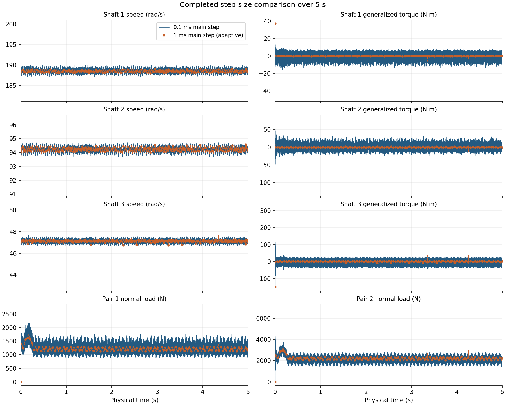
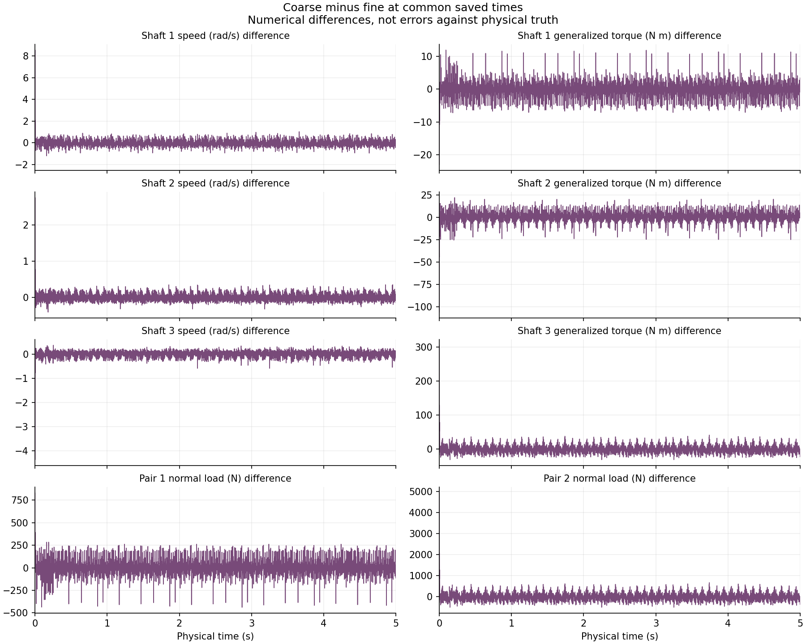

# Five-second GPU reducer at a 1 ms main step

The current-pose mesh backend now completes the same 5 s reducer at a 1 ms main step. The repair rejects an unresolved **trial** contact and retries from the last accepted state with a smaller step. It does not omit contacts, change penalty stiffness, smooth forces, introduce gear-specific logic or call CPU geometry during integration.

## Complete run and actual substeps

Local RTX 3070, the original CPU scene and Gmsh meshes, unchanged loads and HHT parameters. Preprocessing, compilation, uploads and graph instantiation are excluded from online timing.

| Quantity | 0.1 ms regression after repair | 1 ms after repair |
| --- | ---: | ---: |
| Simulated duration | 5 s | 5 s |
| Main steps | 50,000 | 5,000 |
| Online time | 91.99 s | 21.84 / 21.95 s |
| Accepted internal substeps | 50,021 | 5,583 |
| Geometry-failure retries | 0 | 102 |
| Newton rejections / subdivisions | 21 | 481 |
| Body-pair geometry queries | 100,178 | 18,775 |
| Force evaluations | 151,430 | 42,867 |
| Smallest accepted substep | 0.05 ms | 0.0625 ms |
| 99th-percentile main-step wall time | 2.782 ms | 29.095 ms |

The larger-step run is about 4.21 times faster than the repaired 0.1 ms regression. It is still slower than real time: 21.84 s of computation for 5 s of motion. The 1 ms main grid is not a promise that every internal integration step is 1 ms. Its accepted-step histogram is:

| Accepted step | Count |
| --- | ---: |
| 1 ms | 4,494 |
| 0.5 ms | 944 |
| 0.25 ms | 128 |
| 0.125 ms | 15 |
| 0.0625 ms | 2 |

These durations sum to exactly 5 s. All 102 recovered geometry failures were status 27. The first occurred while evaluating time 0.006 s from accepted time 0.005 s, matching the original aborted experiment. The independent repeat produces identical response arrays, rejection counts and substep histograms. [Run](run.json) · [Repeat](repeat.json) · [0.1 ms regression](fine-regression.json).

## Failure diagnosis and repair

The saved failing trial contains 466 triangle hits grouped into six components for the first body pair. The independent CPU OBB / contour-ray query at the same pose also reports `intersecting patch has no finite feature witness`. This establishes that the current finite-feature construction cannot resolve that trial on either implementation; it does not establish that the physical accepted trajectory must pass through that pose. [Trial snapshot](failure-pose.json) · [CPU same-pose query](failure-cpu-query.json).

Previously, a geometry error bypassed Newton's existing time-step rejection path and stopped the entire graph. Now only statuses 26 (unresolved finite support / reach) and 27 (unresolved intersecting group) can reject a noninitial trial and retry at half the interval. The accepted position, velocity, acceleration and force remain untouched. The next attempt clears every contact cache and rebuilds geometry at its new trial pose. Both device-conditional graph and cooperative execution implement this policy. All decisions stay on the GPU.

The existing maximum subdivision level remains eight. If the same geometry error persists at that level, it remains an error; no partial force is accepted. Initial-state geometry errors, enclosure, invalid models and capacity overflow remain fatal. A direct static query of the original failing pose is still unresolved: this change repairs time advancement around rejected trials rather than inventing a force for an unresolved pose. The graph now reports accepted-step histograms, rejection reasons and the first recovered geometry failure after execution.

## Full responses and numerical differences

The reference below is the archived 0.1 ms GPU numerical solution, not physical truth. The repaired 0.1 ms run reproduces its complete 50,001-frame array exactly (SHA-256 `fb18a68d05430015acc80ca8eaeb8387cfe57fd730a334a3d9a8639ceae1d2ec`). Thus the new retry policy preserves that previous successful trajectory.

| Response, 0–5 s | RMS difference at common saved times | Maximum absolute difference |
| --- | ---: | ---: |
| Shaft 1 angular velocity | 0.30759 rad/s | 8.56103 rad/s |
| Shaft 2 angular velocity | 0.10744 rad/s | 2.75297 rad/s |
| Shaft 3 angular velocity | 0.14141 rad/s | 4.37073 rad/s |
| Pair 1 normal load | 81.35 N | 831.71 N |
| Pair 2 normal load | 192.63 N | 4,928.97 N |

Body-pair contact presence agrees at all common times except pair 2 at 0.001 s. This tests body-pair contact presence, not the switching time of every individual tooth region. The larger step suppresses much of the visible high-frequency torque and load variation; smoother curves do not establish higher accuracy. Neither the 1 ms temporal accuracy nor the previously unresolved CPU/GPU peak-load equivalence is accepted by this run.

All 5,001 coarse frames and all 50,001 fine frames are used in the response plot. Difference curves use only the 5,001 common times, without interpolation. The JSON also reports extrema and trapezoidal integrals on each native saved grid; these are sampling diagnostics, not continuous-time peak or momentum-balance guarantees. Internal-substep response peaks were not saved.





[Raw 1 ms response](response.npy) · [Comparison metrics](comparison.json). The initial incomplete 1 ms experiment remains separately archived in [the failure report](../step-1ms/README.md).

## Verification and reproduction

```text
python benchmarks/aes/mesh_bvh_dynamics.py path/to/common-200.scene run-1ms --duration 5 --step 0.001 --blocks 46 --execution graph
python benchmarks/aes/mesh_bvh_dynamics.py path/to/common-200.scene run-01ms --duration 5 --step 0.0001 --blocks 46 --execution graph
python benchmarks/aes/compare_mesh_step_attempt.py results/aes/gpu-mesh-dynamics/responses.npz run-1ms comparison-1ms
python -m unittest discover -s tests -p test_gpu_mesh_dynamics.py -v
```

The nine-test regression includes the existing analytic unilateral oscillator and finite-feature cases, plus a moving tip that initially exceeds finite-feature reach and a terminal initial-enclosure case. The recovery test checks completed time, finite states, direction reversal, substep time coverage and agreement of both GPU execution modes. It does not claim accuracy for an under-resolved impact.

All nine final regressions pass. Compute Sanitizer memcheck reports zero errors for the two added tests, covering both retry execution modes and terminal initial enclosure. [Regression log](regressions.log) · [Memory-check log](memcheck.log).

An exploratory energy assertion in that deliberately stiff **20 ms** tip-plane test failed: final kinetic energy was 0.02577 J against initial 0.005 J. The unchanged HHT/adaptive scheme has no nonlinear energy or temporal-error acceptance criterion; reducing a step only until geometry and Newton converge is insufficient to guarantee either. The final recovery regression therefore has an explicitly narrower scope, while the fine-step analytic accuracy test remains unchanged. The failed exploratory check is retained in [the scope diagnostic](recovery-scope-check.log). This test is distinct from the 1 ms reducer and supplies no reducer energy-accuracy claim.

## Last verified against

2026-11-27, `mesh_graph.cuh`, `mesh_resident.cuh`, `cuda_resident_step.cuh`, `mesh_graph.py` and the benchmark scripts. Complete coarse and fine runs, source hashes, response equality checks, test outcomes and memory-check records are listed in [checks.json](checks.json). CPU long-time performance was not rerun. The CPU same-pose query above is a geometry diagnostic only. `AGENTS.md` was unchanged.
