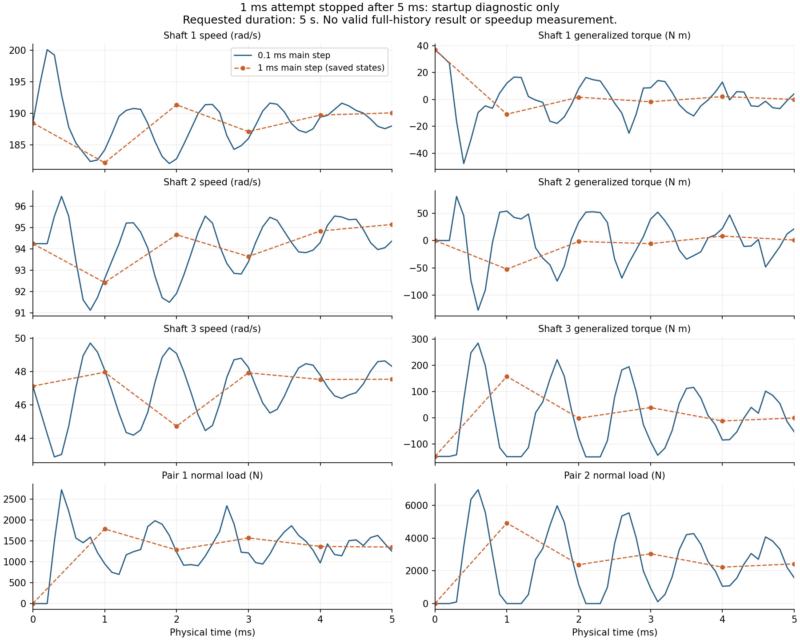

# Reducer with a 1 ms main step: incomplete attempt

The unchanged current-pose GPU mesh backend was asked to advance the same reducer for 5 s, using a 1 ms main step (5,000 main steps), on the local RTX 3070. Scene, meshes, loads, penalty law, HHT parameters and contact algorithms were unchanged. The reference is the archived 0.1 ms **GPU numerical trace**, not an analytical solution. CPU timing was not rerun.

| Main step | Requested duration | Last saved time | Completed main steps | Completed-run online time |
| --- | ---: | ---: | ---: | ---: |
| 0.1 ms, archived reference | 5 s | 5 s | 50,000 | 91.74 s |
| 1 ms, attempt and repeat | 5 s | 0.005 s | 5 | Not available: status 27 |

Both attempts stop in the next main interval with the same status and byte-identical saved response arrays. Before stopping, each reports 269 body-pair geometry queries, 188 force evaluations and seven subdivisions. These counts include work on the failing interval; they are not averages for a completed 5 s simulation. Attempt wall times of 0.494 s and 0.583 s include graph preparation and error/result downloads. They cannot be compared with the completed reference's online time or extrapolated to 5 s. Geometry preprocessing is separately recorded.

## Failure mechanism

`mesh_resident.cuh` reports status 27 when a connected intersecting triangle group supplies neither a positive-depth finite feature witness nor a zero-depth separating bound. The algorithm stops rather than silently omit that contact's force. This identifies the failed stage, not the exact geometric cause: distinguishing a spurious group from an insufficient finite-feature construction requires a same-pose diagnostic of the failing trial.

`mesh_graph_finish_step` subdivides a rejected Newton step only when no geometry status has already been set. Consequently this geometry error terminates the graph; it is not retried at a smaller step. This is an implementation limitation exposed by the 1 ms experiment, not evidence that all implicit methods or this physical system prohibit 1 ms. No force smoothing, contact suppression, larger depth allowance or solver changes were used to make this attempt complete.

## Saved startup responses

Only six states, from 0 to 5 ms, are available. At these common saved times, maximum absolute differences from the 0.1 ms GPU trace are:

| Response | Maximum absolute difference |
| --- | ---: |
| Shaft 1 angular velocity | 8.5610 rad/s |
| Shaft 2 angular velocity | 2.7530 rad/s |
| Shaft 3 angular velocity | 4.3707 rad/s |
| Pair 1 normal load | 831.71 N |
| Pair 2 normal load | 4,928.97 N |

Pair 2 contact presence differs at one of the six common times. These are sampled differences, not errors against physical truth, continuous-time extrema, or a long-time accuracy assessment. The plot retains every available reference sample; it does not subsample its transient peaks to the coarse grid. Lines between the coarse markers only connect saved states. No 1 ms response exists from 0.005 to 5 s, so full-history switching and peak comparisons are unavailable.



[First run](run.json) · [Independent repeat](repeat.json) · [Saved states](response.npy) · [Comparison metrics](comparison.json) · [Verification record](checks.json).

## Reproduction and verification

Extract the [original scene and meshes](../../cpu-foundation/reducer-physics/cpu-deck.zip), preserving relative paths, then run:

```text
python benchmarks/aes/mesh_bvh_dynamics.py path/to/common-200.scene run-1ms --duration 5 --step 0.001 --blocks 46 --execution graph
python benchmarks/aes/compare_mesh_step_attempt.py results/aes/gpu-mesh-dynamics/responses.npz run-1ms comparison-1ms
```

The first command deliberately returns a nonzero exit code on simulation failure while preserving partial frames and status. It does not label an aborted attempt as a completed run. The second command checks that sample times coincide before comparing them; it does not interpolate a reference force peak. The repeat verified the new failure-recording path. No geometry, force or integration kernel changed.

## Last verified against

2026-11-27, backend source at `8967e24`, with only benchmark failure preservation added. Both GPU attempts reproduced status 27 at accepted time 0.005 s; saved arrays, first five status entries, scene hashes and mesh hashes agree. Python generated and visually checked the plot. Complete 5 s validation at 1 ms failed and remains unavailable. The CPU reference and existing 0.1 ms run were read from their archives, not rerun in this experiment.
