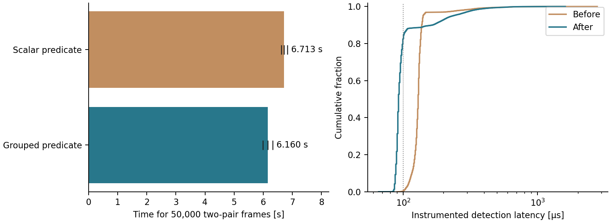
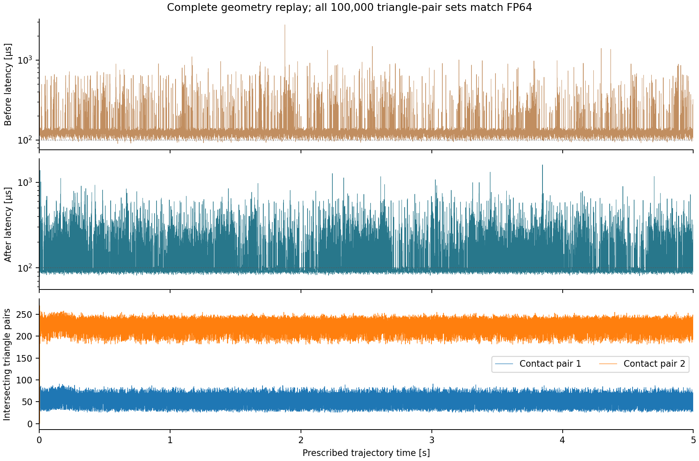
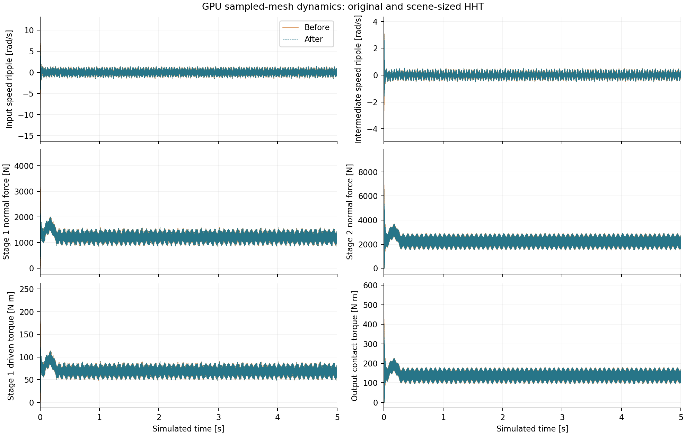

# GPU mesh optimization, 2026-11-27

These measurements separate triangle detection from the existing sampled-mesh dynamics driver. Both use the local RTX 3070, the full five-second reducer interval and a 0.1 ms main step. No CPU simulation was rerun. Preparation, compilation and upload are excluded from online timing. GPU jobs ran separately.

## Triangle detection

`IntersectionBatch` distributes the existing 17-axis FP64 triangle predicate over eight CUDA lanes. The BVH, conservative FP32 rejection, finite-triangle definition and workspace-overflow handling are unchanged. This operates on input triangles and arbitrary rigid transforms; there are no tooth identifiers, gear formulas or configuration-to-force tables. `fine_lanes=1` retains the scalar control.

| Full 50,000-step pose replay | Three online runs, s | Median, s |
| --- | --- | ---: |
| Scalar predicate | 6.621, 6.713, 6.834 | 6.713 |
| Eight-lane predicate | 5.989, 6.330, 6.160 | 6.160 |

The paired medians give an 8.2% wall-time reduction. The separate instrumented run measured 43.33/91.25 microseconds for broad/narrow phases before, and 55.37/56.25 microseconds after. Only the narrow-phase algorithm changed; the broad-phase timing difference is an observed scheduling/timing effect. Earlier isolated trials as low as 4.92 s were not reproduced in this final paired measurement and are not used as the accepted performance claim.

Every triangle-ID set agrees with the archived FP64 implementation over all 100,000 body-pair poses; there are zero discrepancies and zero workspace overflows. The same 65,732 input triangles and frozen CPU poses were used. Hashes and all repetitions are in [comparison.json](comparison.json). The instrumented 99th percentile is 412.67 microseconds, with 8,746 of 50,000 queries exceeding 100 microseconds. This does not establish a real-time deadline guarantee.





## Dynamics scope

The sampled-mesh driver evaluates current geometry throughout the closed loop. It is separate from the CPU contour-ray contact-force formulation and from the `IntersectionBatch` triangle-intersection benchmark. A detection replay is not a dynamics timing. The historical configuration-map GPU package is also not used as the baseline here.

The unchanged sampled-mesh control used 128.581 s, with 30.637 s in preparation, 67.486 s in point searches and 29.892 s in force assembly and HHT. It accepted 799,815 internal increments and made 1,603,242 trials over 50,000 main steps. About 7.19 billion directional point visits remain after candidate culling. A small generalized-coordinate count alone does not remove this repeated work.

The retained solver layout sizes its local tangent matrix to the number of input coordinates. The existing one-to-eight-coordinate limit and state layout remain unchanged. It changes no contact stiffness, geometry sampling, loads, convergence tolerance or timestep criterion. `--solver-layout dynamic` selects the original runtime-sized local matrix for comparison. Results and full response curves are in [the dynamics audit](dynamics/comparison.json).

| Full five-second sampled-mesh dynamics | Online runs, s |
| --- | ---: |
| Original local matrix | 128.581, 128.540 |
| Scene-sized local matrix | 124.838, 124.833 |

This reduces the compiled local stack from 696 to 144 bytes and force assembly/HHT time from about 29.89 to 27.12 s. Total wall time decreases by about 2.9%. The largest normal-load difference from the original response is 2.054e-6 N; the largest contact-torque difference is 1.162e-7 N m. Loading/unloading flags agree at every saved time. These are differences between implementations of the same model, not errors against independent physical truth.

The audit also records two rejected trials. Skipping redundant atomic updates (`winners`, 128.675 s) did not improve time. Publishing the next predictor at the preceding barrier (`predictor`, 127.553 s) changed no response values but saved less than 1%; the scheduling change was removed. Neither is enabled in the retained implementation.



The full dynamics improvement remains small. The CPU contour-ray force construction has not yet been connected to this triangle-intersection path on the GPU. Neither the geometry timing nor the sampled-mesh timing establishes a real-time implementation of that CPU baseline.

## Reproduction

Use the frozen reducer scene, sibling Gmsh parts, CPU trajectory and sampled-mesh deck from the existing validation. Python requires CuPy, NumPy, SciPy, meshio and Matplotlib.

```text
python benchmarks/aes/compare_mesh_predicates.py <scene> <cpu-response.csv> <geometry-output>
python benchmarks/aes/report_mesh_predicates.py <geometry-output>
python benchmarks/aes/resident_assembly.py <deck> <run.json> --trace <run.npy> --method mesh --duration 5 --step-us 100 --broad-phase blocks --guard-mm .8 --stiffness-scope pair --ticks 4096 --contact-samples 16 --explicit-crossing --profile-phases --solver-layout sized
```

Repeat the dynamics command with `--solver-layout dynamic` for the control. The runtime limit remains 30 minutes. Timing curves include all 50,001 saved response frames, without smoothing or clipping the simulated interval.

## Verification

The triangle unit tests cover spatial rotations, swapped bodies, coincident and nearly coincident facets, multiple leaf sizes, group widths 4/8/16/32, bounded-motion reuse and output overflow. All five tests passed; Compute Sanitizer memcheck reported zero errors. Solver-layout validation and the full dynamics comparisons are listed in the dynamics audit. Unit-test intervals serve analytical correctness checks, not long-duration performance claims.
