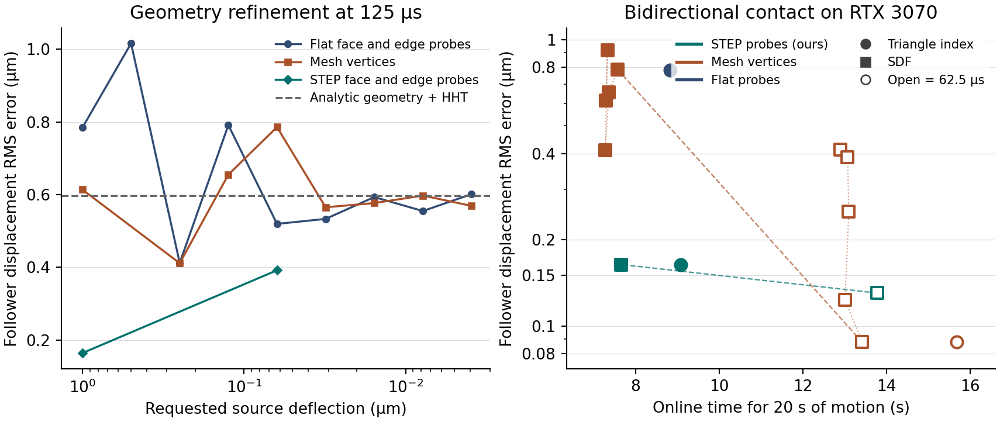

# Displacement accuracy and online cost of the eccentric cam

The closed-loop runs cover 20 s with a revolute cam and a translating follower. The independent CPU reference uses the eccentric circle's analytic support and DOP853. Displacement errors use every output sample. Event errors compare the midpoint between consecutive outputs with an opposite contact state to the corresponding continuous-time reference event.

## Matched GPU comparisons

Both directions query the moving surfaces and share one normal spring per pair of regions. The GPU triangle index selects candidates for double-precision closest-point queries. The GPU SDF alternative interpolates eight signed distances sampled from the target mesh and evaluates the gradient of that interpolant. Its face label comes from the closest grid node. The search uses the same rigid transforms, normal force law, broad phase and HHT equations. The flat working face is especially favorable for trilinear interpolation. A pitch sweep tested 2, 4 and 8 mm. Single-lane and 16-lane triangle search controls are archived. [Search trials](search-controls.json)

| Bidirectional configuration on RTX 3070 | Main step (µs) | Cam triangles | Displacement RMS (µm) | Largest switch error (µs) | Online median (s) | Setup (s) | CuPy pool (MiB) |
|---|---:|---:|---:|---:|---:|---:|---:|
| STEP probes + triangle index (ours) | 125 | 4,068 | 0.164 | 62.81 | 9.08 | 4.25 | 21.45 |
| Flat mesh face and edge probes + triangle index | 125 | 4,068 | 0.784 | 85.23 | 8.82 | 5.73 | 21.45 |
| STEP probes + grid SDF (ours) | 125 | 4,068 | 0.164 | 62.81 | 7.65 | 7.52 | 18.48 |
| Mesh vertices + grid SDF | 125 | 16,284 | 0.786 | 123.94 | 7.57 | 13.31 | 30.47 |
| STEP probes + grid SDF (ours) | 62.5 | 4,068 | 0.130 | 37.92 | 13.77 | 7.99 | 31.91 |
| Mesh vertices + grid SDF | 62.5 | 11,516 | 0.124 | 37.92 | 13.01 | 7.88 | 39.19 |
| Mesh vertices + grid SDF | 62.5 | 16,284 | 0.088 | 36.25 | 13.42 | 15.76 | 43.90 |
| Mesh vertices + triangle index | 62.5 | 16,284 | 0.088 | 36.25 | 15.68 | 31.06 | 50.23 |

All listed rows recover 36 engagements and 35 releases in order. Online times are medians of three fresh-process simulations of one mechanism. Setup is the last measured model setup, including target indexes or fields for both directions. The CuPy allocator's reserved memory includes reusable blocks and the device trace. STEP loading and tessellation for 1 and 0.0625 µm deflections took 2.31 and 5.78 s in the preparation sweep. The 1 µm STEP probe cache added 0.54 s. These offline costs apply when preparing a new part. [Bidirectional measurements](symmetric-controls.json) · [Matched coarse-step mesh controls](symmetric-mesh-125.json) · [Geometry preparation and refinement](accuracy-cost.json)

Using 0.164 µm as a common RMS ceiling, the 7.65 s STEP/SDF run at 125 µs and the 13.01 s mesh/SDF run at 62.5 µs qualify. At the common 62.5 µs step, the 4,068-, 5,756-, 8,140-, 11,516- and 16,284-triangle mesh vertex controls gave 0.414, 0.388, 0.251, 0.124 and 0.088 µm. The first tested mesh to meet the ceiling had 11,516 triangles. Its three-run median was 13.01 s against 13.77 s with 4,068 triangles for STEP/SDF. This is a comparison at nearly matched error and event timing. The STEP version uses fewer triangles and a smaller GPU pool. [Density sweep at both time steps](mesh-density.json) · [Repeated 11,516-triangle run](density-confirmation.json)



## Why a single resolution is misleading

Keeping 125 µs fixed, the flat face/edge mesh gave 0.784, 1.016, 0.412, 0.791 and 0.519 µm RMS at requested deflections of 1, 0.5, 0.25, 0.125 and 0.0625 µm. At 0.00390625 µm the corresponding error was 0.601 µm, and the mesh-vertex variant gave 0.569 µm. Replacing the geometry with the analytic cam support and moment arm gave 0.596 µm for fixed-step HHT at 125 µs, 0.074 µm at 62.5 µs and 0.011 µm at 31.25 µs. The norms in this integrator-only check use the common 125 µs output grid. The measured 0.164 µm includes numerical error cancellation. [Fine mesh checks on RTX 3090](fine-mesh-3090.json) · [Exact-geometry HHT](time-error.json) · [Joint refinement of geometry and time step](step-controls.json)

## Equivalent geometry and reversed bodies

A real STEP edge splits the follower's working face across the width of the contact. The one-sided solver changed from 71 to 101 switches, with a displacement RMS error of 887 µm. At 309 identical poses the largest change was 18.90 N in the force vector and 0.432 N·m in cam-axis torque. Merging connected coplanar face labels restored the one-sided load and displacement histories at every output sample. In four archived gear windows this rule collapsed no simultaneous face pairs across 1,598 multiple-pair poses. The audit checks face identities. [Fixed-pose and dynamic audit](representation.json) · [Gear region audit](gear-region-check.json)

Forcing the sparse follower mesh to supply the samples gave 364 switches and 8.94 mm RMS displacement error. Querying both bodies and choosing the deeper witness per pair restored 71 switches with either body order. Reversing the input order changed displacement by at most 9.3 × 10⁻⁹ µm. With the raw split mesh, reverse-side sampling still introduces new positions and changes displacement by up to 0.292 µm. Unifying common STEP faces and edges before tessellation restored the same 12-triangle follower and identical displacement and normal-force traces for the two STEP representations. This audit covers this planar split and a frictionless cam. [Unification runs](unified-cam.json)

## Reproduction

Use the deck preparation command in the [cam validation](README.md). The following scripts take the independent reference from the physical model and keep raw traces under the build directory. Each child simulation has a 1,800 s timeout.

```text
python benchmarks/aes/cam_accuracy_cost.py build/cam-cost results/aes/resident-cam/accuracy-cost.json
python benchmarks/aes/cam_search_controls.py build/cam-cost results/aes/resident-cam/search-controls.json
python benchmarks/aes/cam_step_controls.py build/cam-cost results/aes/resident-cam/symmetric-controls.json --symmetric
python benchmarks/aes/cam_step_controls.py build/cam-cost results/aes/resident-cam/symmetric-mesh-125.json --symmetric-mesh-125
python benchmarks/aes/cam_step_controls.py build/cam-cost results/aes/resident-cam/mesh-density.json --mesh-density
python benchmarks/aes/cam_step_controls.py build/cam-cost results/aes/resident-cam/density-confirmation.json --confirm-density
python benchmarks/aes/cam_time_error.py build/cam-cost results/aes/resident-cam/time-error.json
python benchmarks/aes/cam_representation.py build/cam-roles results/aes/resident-cam/representation.json
python benchmarks/aes/cam_representation.py build/cam-roles results/aes/resident-cam/unified-cam.json --unified-only
python benchmarks/aes/gear_region_check.py results/aes/resident-cam/gear-region-check.json
python benchmarks/aes/cam_accuracy_figure.py results/aes/resident-cam
```
