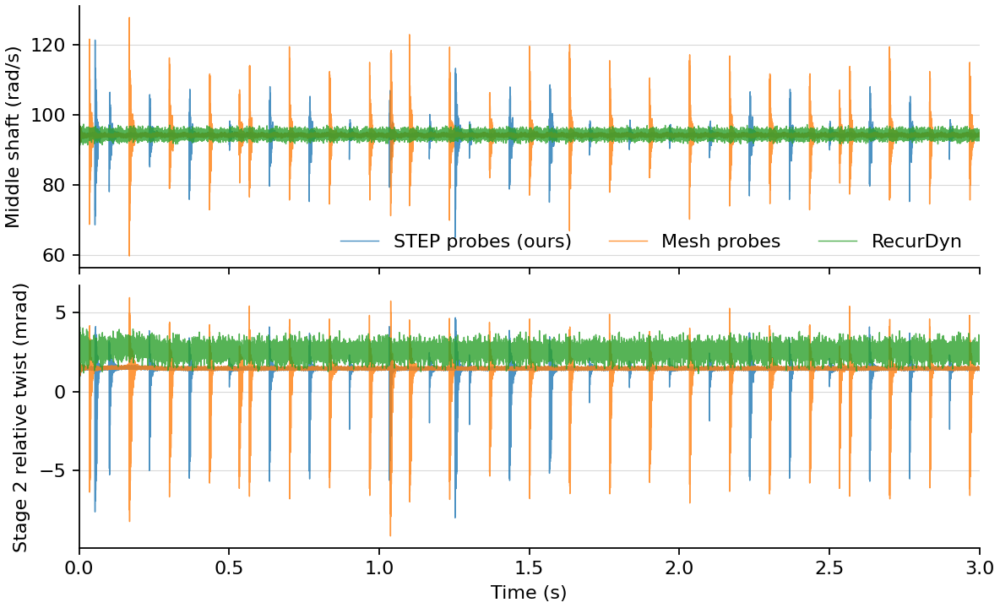

# Shared-shaft dynamics of the two-stage STEP reducer

The four original gear solids have 339,868 triangles at a requested 1 µm tessellation deflection. The two gears on the middle shaft share a single angular displacement and velocity. At every trial the solver sums both contact torques in that shaft's HHT equation. The model specifies the two mating body pairs. Contact discovery searches the full parts with a spatial triangle index in each direction. The same GPU code handles the eccentric cam, without a tooth index or an analytic gear contact formula. The driver currently supports up to eight independent ground-referenced hinge or slider coordinates. [Model and loads](../../../benchmarks/aes/resident_reducer.py) · [GPU assembly](../../../benchmarks/aes/resident_assembly.cuh)

## Three seconds of loaded rotation

Both GPU methods use the same mesh, broad phase, region aggregation, linear normal spring, support torques and time integrator. The STEP version samples source points on the original CAD faces and edges before simulation. The mesh control places them on flat triangles and straight edges. Both query the target triangles online. The 62.5 µs runs used identical contact refinement and reached the end with zero explicit fallback steps. Geometry preparation including STEP probes took 211.7 s once for all four parts.

| Method | Main step (µs) | Simulated (s) | Online (s) | Setup (s) | GPU step P99 (ms) | Steps over budget |
|---|---:|---:|---:|---:|---:|---:|
| STEP probes + indexed triangle search (ours), RTX 3090 | 62.5 | 3.000 | 236.48 | 5.25 | 6.24 | 48,000 / 48,000 |
| Mesh probes + indexed triangle search, RTX 3090 | 62.5 | 3.000 | 233.19 | 6.94 | 6.46 | 48,000 / 48,000 |
| STEP probes + indexed triangle search (ours), RTX 3090 | 125 | 3.000 | 236.27 | 6.99 | 12.31 | 24,000 / 24,000 |
| Mesh probes + indexed triangle search, RTX 3090 | 125 | 0.754 | 59.16 to Newton failure | 5.22 | — | — |
| RecurDyn 2023 native solid contact | 125 output and maximum internal | 3.000 | 594.44 | 175.85 | — | — |

Each GPU row is one measured simulation. The reserved CuPy pool was 502.19 and 502.22 MiB for the STEP and mesh rows at 62.5 µs. The timestep deadline is the simulated time advance per main step. The two completed 62.5 µs runs took 1,352,302 and 1,333,269 contact/dynamics trials, including 665,822 and 655,624 accepted time increments, respectively. The RecurDyn online clock covers its Analysis call. Its solver log records 555.15 s of CPU time. The commercial solver uses its native integration and solid-contact discretization, with the same physical parts, shaft inertias, nominal motion, load laws and linear stiffness. The GPU load histories use linear interpolation of a 0.5 ms deck while RecurDyn evaluates the analytic load functions. The archived run history includes coarser refinement attempts that stopped early. [Timing and termination records](comparison.json)

## Independent shaft response

Velocities are measured about each joint's own positive axis. For each stage we compare the change in pinion angle minus twice the change in wheel angle, in the respective positive directions. RecurDyn's cumulative `Pos1_Relative` joint channels supply the angles directly. Unit conversion is checked against the prescribed reference rotors. All three trajectories are scored on the same 24,001 physical times. RMS differences below are relative to the native RecurDyn simulation.

| GPU configuration | Input speed (rad/s) | Middle speed (rad/s) | Output speed (rad/s) | Stage 1 twist (mrad) | Stage 2 twist (mrad) |
|---|---:|---:|---:|---:|---:|
| STEP probes (ours), 62.5 µs | 5.79 | 1.66 | 1.63 | 1.31 | 1.43 |
| Mesh probes, 62.5 µs | 7.93 | 2.32 | 2.30 | 1.52 | 1.59 |
| STEP probes (ours), 125 µs | 5.98 | 1.69 | 1.69 | 1.33 | 1.44 |



The short speed excursions are visible in both GPU histories. At 62.5 µs the largest middle-shaft difference from RecurDyn was 28.40 rad/s for the STEP run and 34.80 rad/s for the mesh run. The STEP input-shaft maximum was larger than the mesh maximum. The archive distinguishes the GPU sum of scalar normal loads across active regions, the commercial solver's force resultant, and its first contact point's normal force. They measure different quantities. The cross-solver assessment therefore uses the shaft motion. A separate cam regression over 2,000 main steps checked the new shared-coordinate driver against the original two-coordinate driver. The largest follower displacement and normal force differences were 8.93 × 10⁻⁶ µm and 3.94 × 10⁻⁸ N. [Response arrays and direct angles](responses.npz) · [Vector figure](shaft-response.pdf)

The largest STEP middle-shaft difference occurs at 1.25275 s. At that output the GPU gives 65.06 rad/s and RecurDyn gives 93.47 rad/s. The GPU reports 17.89 kN of summed normal load in stage 1 and zero in stage 2. The mesh's largest middle-shaft difference occurs at 0.167375 s, with zero stage 1 load and 37.66 kN in stage 2. These times identify specific contact transitions for replay from the same shaft poses.

## Reproduction

Run from the repository root. Geometry preparation uses OpenCascade. The online solver uses CuPy and a CUDA device with cooperative launch. The independent simulation uses RecurDyn 2023 ProcessNet on Windows. All experiments used a 1,800 s limit per simulation. Run the following commands with paths appropriate to the machine.

```text
python benchmarks/aes/resident_reducer.py build/resident-reducer
python benchmarks/aes/resident_assembly.py build/resident-reducer build/resident-reducer/cad-h62.json --trace build/resident-reducer/cad-h62.npy --method cad --step-us 62.5 --contact-samples 16 --ticks 4096 --explicit-crossing
python benchmarks/aes/resident_assembly.py build/resident-reducer build/resident-reducer/mesh-h62.json --trace build/resident-reducer/mesh-h62.npy --method mesh --step-us 62.5 --contact-samples 16 --ticks 4096 --explicit-crossing
python benchmarks/aes/recurdyn_reducer.py build/resident-reducer build/resident-reducer/rd-full.json
python benchmarks/aes/recurdyn_reducer.py build/resident-reducer build/resident-reducer/rd-joints.npz --plot build/resident-reducer/rd-reducer-3s-125us_01/rd-reducer-3s-125us.rplt
python benchmarks/aes/assembly_comparison.py build/resident-reducer results/aes/resident-reducer
```

For the 125 µs controls use `--step-us 125 --contact-samples 16 --ticks 4096` and save as `cad-refined` or `mesh-refined`. For the optional cam regression run the assembly solver with `--cam-deck build/resident-cam/deck-0mm-125us.npz --cam-cache build/resident-cam/cam-probes.npz --pitch 4 --duration 0.25`, save `cam-audit.npy` in the reducer work directory, and pass `--cam-control build/cam-roles/original.npy` to the scoring command. [Cam experiments](../resident-cam/accuracy-study.md)
